<div align="center">

<a href="https://flyhead.live/">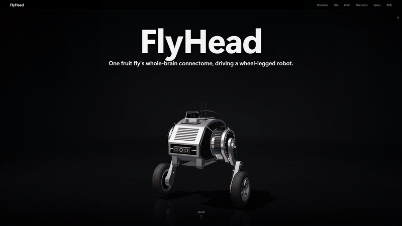</a>

<h3>A fruit fly's whole-brain connectome, simulated on a GPU, driving a real wheel-legged robot.</h3>

<a href="https://flyhead.live/"></a>

<p>


</p>

<p>
<b>English</b> · <a href="README.zh-CN.md">中文</a> ·
<a href="https://flyhead.live/">Website</a> ·
<a href="#demonstrations">Demos</a> ·
<a href="#system-overview">System</a> ·
<a href="#quick-start">Quick start</a>
</p>

<sub>Above: a 3D render captured from the website, not a photo of the robot. Real footage follows.</sub>

</div>

## The real robot, driven by the fly brain

<table>
<tr>
<td width="55%" valign="top">

<p> <sub>Phone footage · <a href="docs/media/real/stage5_004_brain_drive_escape.mp4">mp4</a></sub></p>
</td>
<td width="45%" valign="top">

**A person walks up. LiDAR looming drives identified visual neurons, the connectome responds, and a decoder reads descending neurons into motion.**

* **138,639** LIF neurons and **15,091,983** connection records (FlyWire v783)
* LiDAR looming → LC4 / LPLC2 / LC9 → descending neurons (DNp01, DNa02, MDN) → escape, turning, walking
* A safety envelope may only reduce or zero the brain's commands

</td>
</tr>
</table>

The stimulus encoders and the decoder are engineering proxies, not a reconstruction of fly vision or motor control.

## Explore it in 3D

**Each card opens that chapter on [flyhead.live](https://flyhead.live/)**: scroll to disassemble the robot, drag to rotate, switch scenarios.

<table>
<tr>
<td width="33%" valign="top">
<a href="https://flyhead.live/#p=0.15">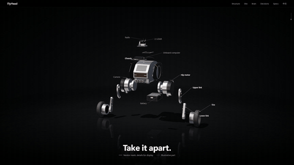</a>
<p> <b><a href="https://flyhead.live/#p=0.15">Take it apart</a></b></p>
<p><sub>Vendor meshes plus illustrative parts; scroll to disassemble</sub></p>
</td>
<td width="33%" valign="top">
<a href="https://flyhead.live/#p=0.42">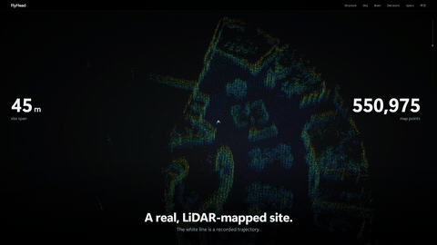</a>
<p> <b><a href="https://flyhead.live/#p=0.42">The mapped site</a></b></p>
<p><sub>Point cloud from a real LiDAR mapping session</sub></p>
</td>
<td width="33%" valign="top">
<a href="https://flyhead.live/#p=0.48">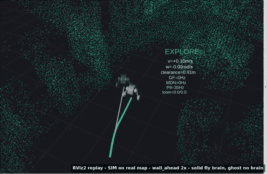</a>
<p> <b><a href="https://flyhead.live/#p=0.48">Brain vs. no brain</a></b></p>
<p><sub>Closed-loop simulation; selected scenarios, not an average</sub></p>
</td>
</tr>
<tr>
<td width="33%" valign="top">
<a href="https://flyhead.live/#p=0.65">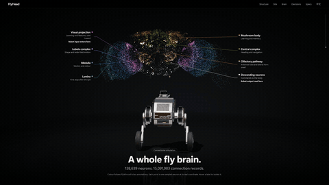</a>
<p> <b><a href="https://flyhead.live/#p=0.65">A whole fly brain</a></b></p>
<p><sub>Real FlyWire coordinates; a sample of the neurons is drawn</sub></p>
</td>
<td width="33%" valign="top">
<a href="https://flyhead.live/#p=0.81">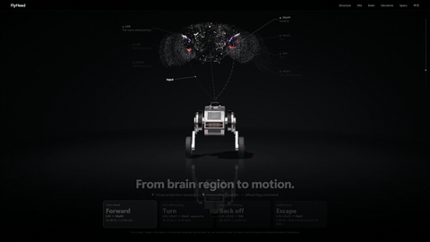</a>
<p> <b><a href="https://flyhead.live/#p=0.81">From brain region to motion</a></b></p>
<p><sub>Simulated rates, an engineering decoder; signal animation is illustrative</sub></p>
</td>
<td width="33%" valign="top">
<a href="https://flyhead.live/#p=0.915">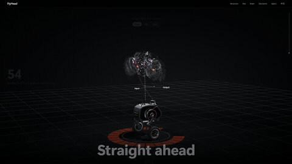</a>
<p> <b><a href="https://flyhead.live/#p=0.915">Decisions, window by window</a></b></p>
<p><sub>Real-robot brain windows; selected episodes, the person is illustrative</sub></p>
</td>
</tr>
</table>

## Two decision layers in one body

| | |
| --- | --- |
| **Autonomous navigation** | LiDAR SLAM on a saved map of the building, centreline route planning, tours, detours and a host safety chain. Works on its own, without the brain. |
| **Fly brain** | The complete FlyWire v783 *Drosophila* connectome on a GPU turns LiDAR looming into escape, turning and walking through identified descending neurons. A safety envelope may only reduce or zero its commands. |

Hardware: a DIABLO wheel-legged robot (Raspberry Pi 4B, ROS 2 Foxy, Unitree L1 LiDAR), a GPU compute host
and a Windows operator PC. *Xingtian (刑天) fights on after losing his head; here a fly brain is the head.*

---

## Demonstrations

<p>
 physical robot (phone footage) &nbsp;
 the robot's own logs, replayed &nbsp;
 the saved SLAM map of the real building &nbsp;
 simulated LiDAR, full connectome on GPU &nbsp;
 real console and server, replayed session
</p>

### The real robot

<table>
<tr>
<td width="50%" valign="top">

<p> <b>Autonomous navigation · hallway</b></p>
<p><sub>Standing / crouched posture and route driving, no fly brain · <a href="docs/media/real/hallway_posture_drive.mp4">mp4</a></sub></p>
</td>
<td width="50%" valign="top">

<p> <b>Autonomous navigation · office at night</b></p>
<p><sub>Route driving through the mapped office, no fly brain · 4× · <a href="docs/media/real/office_night_drive_4x.mp4">mp4</a></sub></p>
</td>
</tr>
<tr>
<td width="50%" valign="top">

<p> <b>The fly brain drives</b></p>
<p><sub>A person approaches and the robot escapes · <a href="docs/media/real/stage5_004_brain_drive_escape.mp4">mp4</a></sub></p>
</td>
<td width="50%" valign="top">

<p> <b>Autonomous tour, from the robot's log</b></p>
<p><sub>Every frame is one recorded navigator message · <a href="docs/media/realmap/real_tour_729s.mp4">mp4</a> · <a href="docs/media/realmap/real_tour_138s.mp4">short tour</a></sub></p>
</td>
</tr>
</table>

### The real site: SLAM map

<table>
<tr>
<td width="50%" valign="top">

<p> <b>The mapping session, replayed</b></p>
<p><sub>The map grows along the mapping path · <a href="docs/media/realmap/slam_map_build.mp4">mp4</a></sub></p>
</td>
<td width="50%" valign="top">

<p> <b>The saved point cloud in 3-D</b></p>
<p><sub>Walls and furniture, coloured by height · <a href="docs/media/realmap/slam_map_orbit.mp4">mp4</a></sub></p>
</td>
</tr>
</table>

<a href="docs/media/realmap/nav_layers.png"></a>

<sub>Navigation layers of the saved map: occupancy grid · clearance field and the centreline every route follows · obstacle heights · the mapping path and real tours. Published with the site owner's consent; the map package itself is not in this repository.</sub>

### The fly brain on the real map

<table>
<tr>
<td width="50%" valign="top">
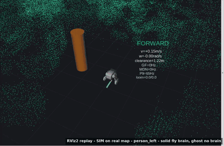
<p> <b>The decision chain, window by window</b></p>
<p><sub>A person from the left: LiDAR → LC4/LPLC2/LC9 → descending neurons → decoder → command · <a href="docs/media/rviz/person_left.mp4">mp4</a></sub></p>
</td>
<td width="50%" valign="top">
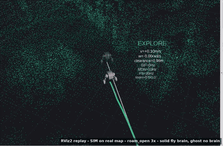
<p> <b>Free roaming</b></p>
<p><sub>Explore, escape, flee, freeze and hold in one run · <a href="docs/media/rviz/roam_open.mp4">mp4</a></sub></p>
</td>
</tr>
<tr>
<td width="50%" valign="top">
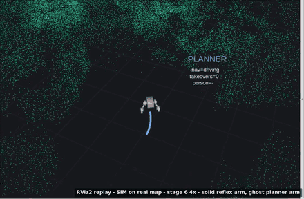
<p> <b>Planner with fly reflexes</b></p>
<p><sub>The planner drives to a goal; the brain takes over when something looms · <a href="docs/media/rviz/stage6.mp4">mp4</a></sub></p>
</td>
<td width="50%" valign="top">

<p> <b>Operator console on the real map</b></p>
<p><sub>Relocalization, brain in shadow mode, charging lock on · <a href="docs/media/realmap/console/console_real_map_brain_shadow.mp4">mp4</a></sub></p>
</td>
</tr>
</table>

More scenarios: [person front](docs/media/rviz/person_front.mp4) · [person right](docs/media/rviz/person_right.mp4) ·
[wall ahead](docs/media/rviz/wall_ahead.mp4) · [loom front](docs/media/rviz/loom_front.mp4) ·
[loom left](docs/media/rviz/loom_left.mp4) · [loom right](docs/media/rviz/loom_right.mp4).
The simulation clips are RViz2 replays of recorded 100 ms windows ([tools/rviz_replay](tools/rviz_replay)); no robot is connected.

### The operator console

<table>
<tr>
<td width="50%" valign="top"><a href="docs/media/realmap/console/tab_home.png"></a><br><sub><b>Home</b> · session, map, tours</sub></td>
<td width="50%" valign="top"><a href="docs/media/realmap/console/tab_mission.png"></a><br><sub><b>Mission</b> · goals, limits, brain modes</sub></td>
</tr>
<tr>
<td width="50%" valign="top"><a href="docs/media/realmap/console/tab_drive.png"></a><br><sub><b>Drive</b> · chassis, posture</sub></td>
<td width="50%" valign="top"><a href="docs/media/realmap/console/tab_display.png"></a><br><sub><b>Display</b> · views, map changes</sub></td>
</tr>
</table>

---

## System overview

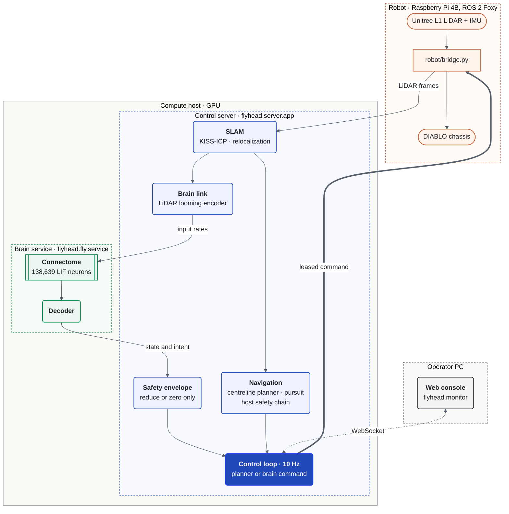

The connectome model is the FlyWire v783 LIF model from [eonsystemspbc/fly-brain](https://github.com/eonsystemspbc/fly-brain)
with unmodified equations and no learning. Neurons are bound by exact `cell_type` → `root_id` → model index
([`configs/fly/loom_registry.json`](configs/fly/loom_registry.json)). Navigation is classical SLAM and planning and
does not depend on the brain. Module boundaries: [docs/architecture.md](docs/architecture.md).

---

## Repository layout

| Path | Role | Runs on |
| --- | --- | --- |
| [`flyhead/fly/`](flyhead/fly) | connectome model, encoders, decoders, brain service | GPU host |
| [`flyhead/slam/`](flyhead/slam) | KISS-ICP odometry, relocalization, map layers | compute host |
| [`flyhead/navigation/`](flyhead/navigation) | route planning, following, host stop / slow / detour chain | compute host |
| [`flyhead/server/`](flyhead/server) | control server, robot session, control loop, brain link | compute host |
| [`flyhead/safety/`](flyhead/safety) | command envelope (reduce or zero only) | compute host |
| [`flyhead/sim/`](flyhead/sim) | closed-loop simulations, synthetic arena, report | any (brain arm: GPU) |
| [`flyhead/monitor/`](flyhead/monitor) | operator web console | operator PC |
| [`robot/`](robot) | ROS 2 bridge (LiDAR, IMU, chassis, posture), standalone | robot |
| `configs/`, `scripts/`, `tools/`, `tests/` | neuron registry, launchers, map tools, renderers, unit tests | — |

---

## Quick start

Unit tests and a simulation without the brain, on any machine:

```bash
git clone https://github.com/12sqawdwq/FlyHead.git && cd FlyHead
python -m venv .venv && . .venv/bin/activate        # Windows: .venv\Scripts\activate
pip install -e ".[dev]" && pytest
python -m flyhead.sim.loom_sim person_front blind 25 runs/blind.jsonl
python -m flyhead.sim.report runs/blind.jsonl
```

With a CUDA GPU (≥ 16 GB free), the connectome in the loop:

```bash
pip install -e ".[brain]"
python scripts/fetch_upstream.py                    # pinned fly-brain code + FlyWire v783, identity-checked
python -m flyhead.sim.loom_sim person_front brain 25 runs/brain.jsonl --decoder 9
```

The robot, the control server and the console: [docs/reproduce.md](docs/reproduce.md) and
[docs/slam_operations.md](docs/slam_operations.md).

## Safety

Physical motion needs two explicit opt-ins on both the compute host and the robot
(`XT_CHASSIS_DISABLED=0`, `XT_REMOTE_MOTION_ENABLED=1`); the default is a charging lock. Every velocity
command carries a deadline of at most 0.3 s on the robot clock, the bridge zeroes motion after 2 s without
server traffic, and the brain's commands pass a safety envelope that can only reduce or zero them. An RC
supervisor is expected during any drive. This is research code, not a product.

## Documentation

| Document | What it covers |
| --- | --- |
| [docs/architecture.md](docs/architecture.md) | machines, processes, module boundaries, data flow per window |
| [docs/reproduce.md](docs/reproduce.md) | from unit tests to the real robot |
| [docs/control_arbitration.md](docs/control_arbitration.md) | one motion source at a time, preemption, consoles |
| [docs/slam_operations.md](docs/slam_operations.md) | hosts, interlocks, interfaces, map packages, troubleshooting |
| [tools/rviz_replay](tools/rviz_replay) | replaying recorded simulations in RViz2 |

## Credits and licences

* Connectome model: [eonsystemspbc/fly-brain](https://github.com/eonsystemspbc/fly-brain) (GPL-2.0), fetched at a pinned commit, not redistributed here.
* Connectome and annotations: FlyWire (Dorkenwald et al. 2024, Schlegel et al. 2024; [flyconnectome/flywire_annotations](https://github.com/flyconnectome/flywire_annotations)).
* LiDAR odometry: [KISS-ICP](https://github.com/PRBonn/kiss-icp). Web console: [three.js](https://threejs.org) (MIT, vendored with its licence). Robot meshes: [DDTRobot/diablo_ros2](https://github.com/DDTRobot/diablo_ros2) (Apache-2.0).

No licence has been chosen for FlyHead's own code yet; until one is added, all rights are reserved by the author.

---

<div align="center">

**[See it in 3D at flyhead.live →](https://flyhead.live/)**

</div>
