<div align="center">

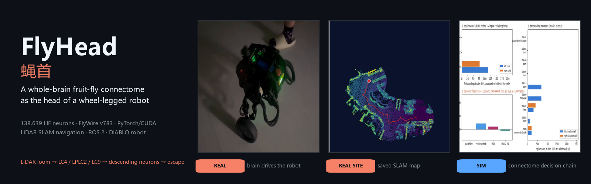

<p>


</p>

<p>
<b>English</b> · <a href="README.zh-CN.md">中文</a> ·
<a href="#-gallery">Gallery</a> ·
<a href="#-state-coverage">State coverage</a> ·
<a href="#-quick-start">Quick start</a> ·
<a href="docs/demo.md">Demo page</a> ·
<a href="docs/architecture.md">Architecture</a> ·
<a href="docs/verification.md">Verification</a> ·
<a href="experiments/README.md">Experiments</a>
</p>

</div>

FlyHead is a research robot with **two decision layers in one body**:

| | |
| --- | --- |
| 🧭 **Autonomous navigation** | LiDAR SLAM on a saved map of the building, centreline route planning, tours, detours and a host safety chain. Works on its own, without the brain. |
| 🧠 **The fly brain** | The complete FlyWire v783 *Drosophila* connectome on a GPU turns LiDAR looming into escape, turning and walking through identified descending neurons. A safety envelope may only reduce or zero its commands. |

Hardware: a DIABLO wheel-legged robot (Raspberry Pi 4B, ROS 2 Foxy, Unitree L1 LiDAR), a GPU compute host
and a Windows operator PC. *Xingtian (刑天) fights on after losing his head; here a fly brain is the head.*

---

## 🎬 Gallery

<p>
 physical robot (phone footage) &nbsp;
 the robot's own logs, replayed &nbsp;
 the saved SLAM map of the real building &nbsp;
 simulated LiDAR, full connectome on GPU &nbsp;
 real console and server, replayed session
</p>

### 🤖 The real robot

<table>
<tr>
<td width="50%" valign="top">
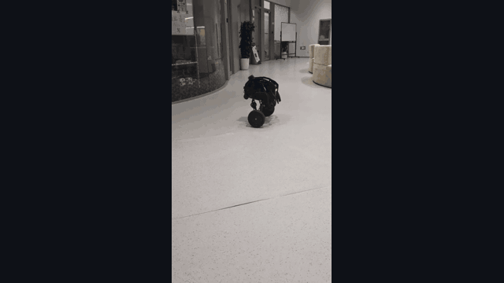
<p> <b>Autonomous navigation · hallway</b></p>
<p><sub>Standing / crouched posture and route driving, no fly brain · 19 s · <a href="docs/media/real/hallway_posture_drive.mp4">mp4</a></sub></p>
</td>
<td width="50%" valign="top">
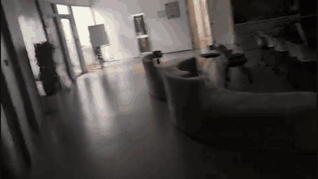
<p> <b>Autonomous navigation · office at night</b></p>
<p><sub>Route driving through the mapped office, no fly brain · 6 min at 4× · <a href="docs/media/real/office_night_drive_4x.mp4">mp4</a></sub></p>
</td>
</tr>
<tr>
<td width="50%" valign="top">
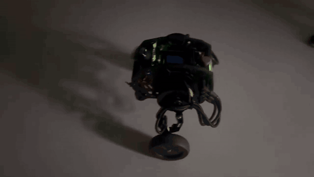
<p> <b>The fly brain drives · stage5_004</b></p>
<p><sub>A person approaches; 262 s of brain drive, 30 escape programs, 0 contacts reported · <a href="docs/media/real/stage5_004_brain_drive_escape.mp4">mp4</a></sub></p>
</td>
<td width="50%" valign="top">
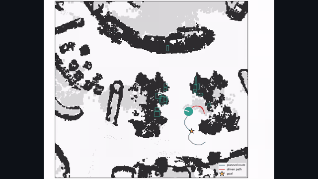
<p> <b>Autonomous tour, from the robot's log</b></p>
<p><sub>2026-10-04 · 729 s, 56.1 m, fitness ≥ 0.963 · <a href="docs/media/realmap/real_tour_729s.mp4">mp4</a> · <a href="docs/media/realmap/real_tour_138s.mp4">138 s tour</a></sub></p>
</td>
</tr>
</table>

### 🗺️ The real site: SLAM map

<table>
<tr>
<td width="50%" valign="top">
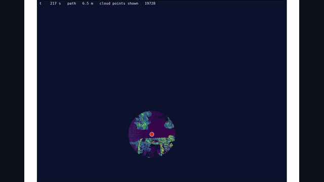
<p> <b>The mapping session, replayed</b></p>
<p><sub>2026-09-25 · 1,407 s, 54.7 m, 550,975 points · <a href="docs/media/realmap/slam_map_build.mp4">mp4</a></sub></p>
</td>
<td width="50%" valign="top">
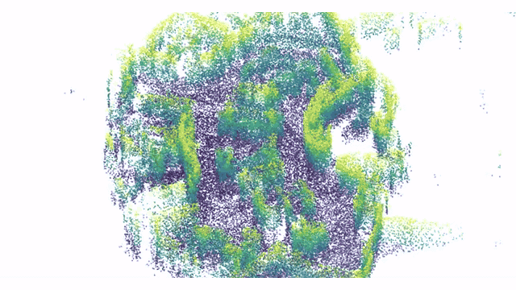
<p> <b>The saved point cloud in 3-D</b></p>
<p><sub>Walls and furniture below 1.3 m, coloured by height · <a href="docs/media/realmap/slam_map_orbit.mp4">mp4</a></sub></p>
</td>
</tr>
</table>

<details>
<summary><b>Navigation layers of the same map</b> (occupancy, clearance and centreline, obstacle heights, real runs)</summary>
<br>

<a href="docs/media/realmap/nav_layers.png">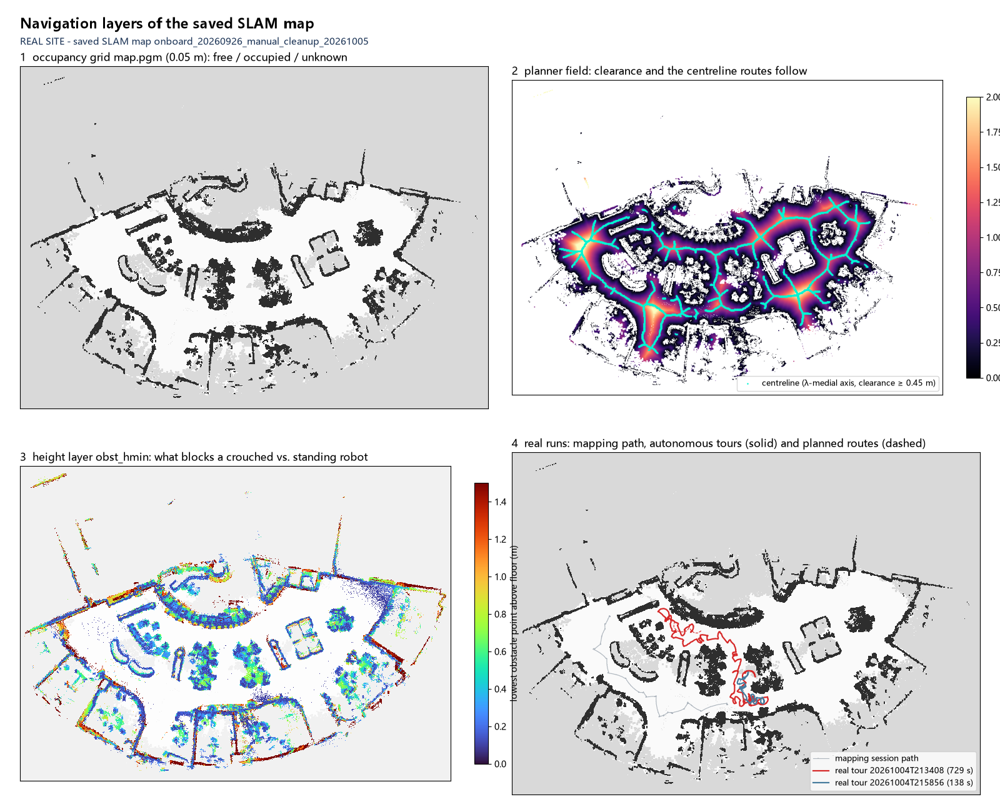</a>

<sub><b>Navigation layers of the same map:</b> occupancy grid · clearance field and the centreline every route follows · obstacle heights (what blocks a crouched or a standing robot) · the mapping path and the real tours.</sub>

</details>

### 🧠 The fly brain on the real map

<table>
<tr>
<td width="50%" valign="top">
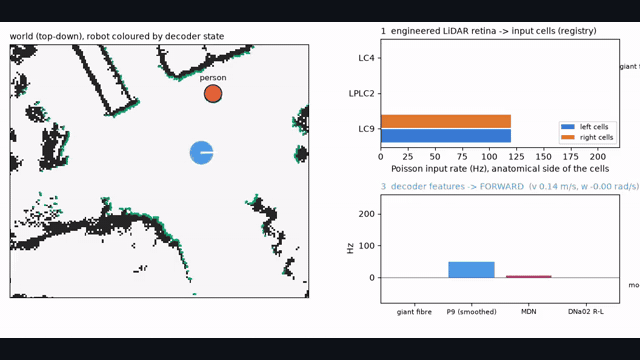
<p> <b>The decision chain, window by window</b></p>
<p><sub>A person from the left: LiDAR → LC4/LPLC2/LC9 → descending neurons → decoder → command · <a href="docs/media/realmap/decision_person_left.mp4">mp4</a></sub></p>
</td>
<td width="50%" valign="top">
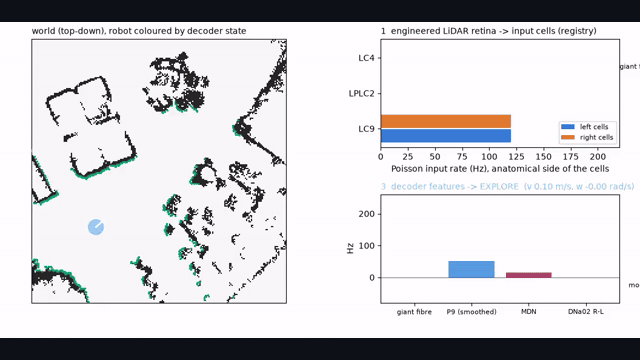
<p> <b>120 s of free roaming</b></p>
<p><sub>18.9 m, 0 contacts; explore, escape, flee, freeze and hold in one run · <a href="docs/media/realmap/decision_roam_open.mp4">mp4</a></sub></p>
</td>
</tr>
<tr>
<td width="50%" valign="top">
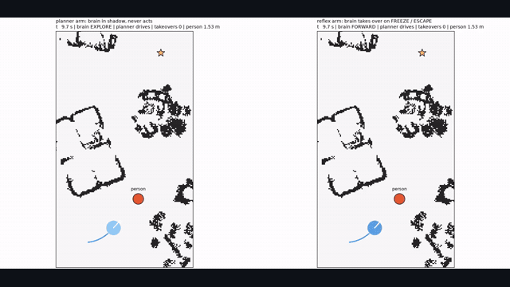
<p> <b>Stage 6: planner vs. fly reflexes</b></p>
<p><sub>Both arms arrive with 0 contacts; the brain takes over twice · <a href="docs/media/realmap/stage6_planner_vs_reflex.mp4">mp4</a></sub></p>
</td>
<td width="50%" valign="top">
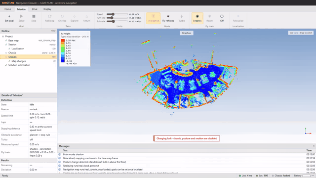
<p> <b>Operator console on the real map</b></p>
<p><sub>Relocalized at fitness 1.00, brain in shadow mode, charging lock on · <a href="docs/media/realmap/console/console_real_map_brain_shadow.mp4">mp4</a></sub></p>
</td>
</tr>
</table>

<details>
<summary><b>All eight brain scenarios on the real map</b> (videos, outcomes, overview figures)</summary>
<br>

| Scenario | What happens | Brain: contacts, min clearance | Blind: contacts | Video |
| --- | --- | --- | --- | --- |
| `person_front` | a person walks at the robot, stops 0.7 m away | 0, 0.69 m | 0 | [mp4](docs/media/realmap/decision_person_front.mp4) |
| `person_left` | the same from the left | 0, 0.70 m | 0 | [mp4](docs/media/realmap/decision_person_left.mp4) |
| `person_right` | the same from the right | 0, 0.56 m | 0 | [mp4](docs/media/realmap/decision_person_right.mp4) |
| `wall_ahead` | a lane toward a far wall | 0, 0.88 m | 0 | [mp4](docs/media/realmap/decision_wall_ahead.mp4) |
| `roam_open` | 120 s free roaming | 0, 0.45 m | 0 | [mp4](docs/media/realmap/decision_roam_open.mp4) |
| `loom_front` | an object at 0.6 m/s that never stops (stress test) | 37, −0.23 m | 19 | [mp4](docs/media/realmap/decision_loom_front.mp4) |
| `loom_left` | the same from the left | 21, −0.23 m | 19 | [mp4](docs/media/realmap/decision_loom_left.mp4) |
| `loom_right` | the same from the right | 21, −0.23 m | 19 | [mp4](docs/media/realmap/decision_loom_right.mp4) |

The `loom_*` objects drive through the robot whatever it does: the brain escapes, the object follows. They
count contacts and are not passed scenarios.

<a href="docs/media/realmap/scenarios_brain_vs_blind.png">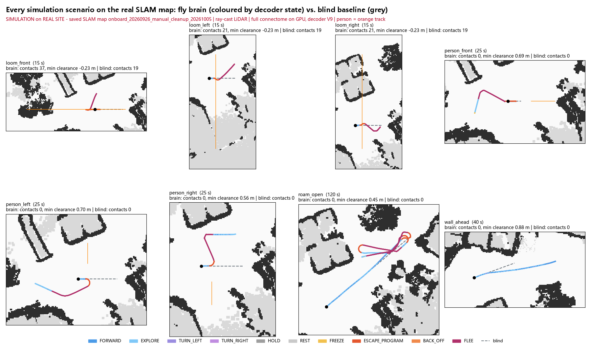</a>
<a href="docs/media/realmap/decoder_states.png">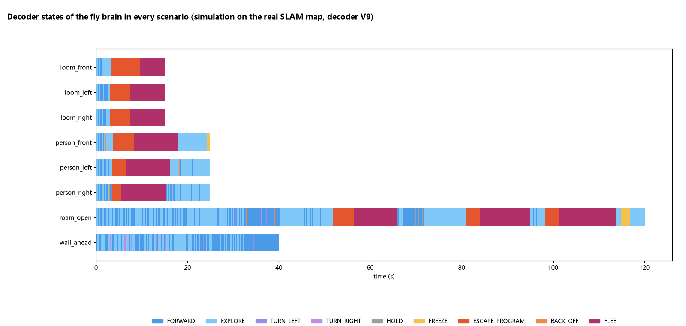</a>

</details>

<details>
<summary><b>The four console tabs</b> and what the replay is</summary>
<br>

<table>
<tr>
<td width="25%"><a href="docs/media/realmap/console/tab_home.png">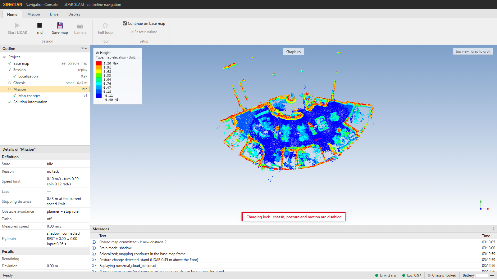</a><br><sub><b>Home</b> · session, map, tours</sub></td>
<td width="25%"><a href="docs/media/realmap/console/tab_mission.png">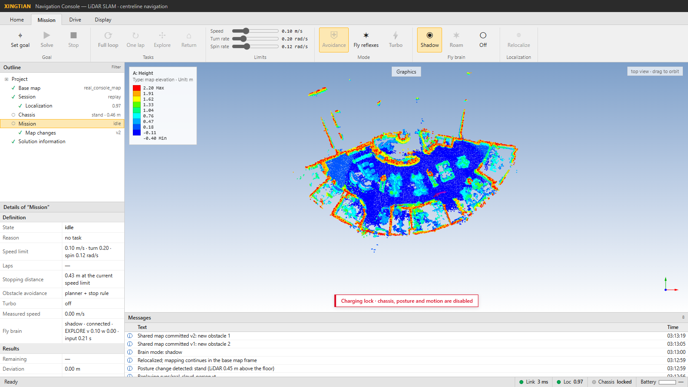</a><br><sub><b>Mission</b> · goals, limits, brain modes</sub></td>
<td width="25%"><a href="docs/media/realmap/console/tab_drive.png">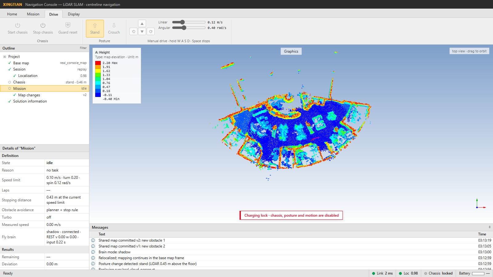</a><br><sub><b>Drive</b> · chassis, posture</sub></td>
<td width="25%"><a href="docs/media/realmap/console/tab_display.png">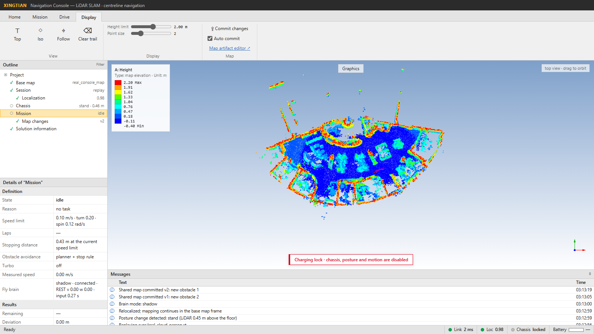</a><br><sub><b>Display</b> · views, map changes</sub></td>
</tr>
</table>

The console and server are real; the session is a replay whose scans were taken from the saved point cloud
along a scripted path, with a person added. Shown: relocalization, posture (stand, LiDAR 0.45 m), the person
committed as a map change, and the brain's shadow decisions (HOLD, EXPLORE, TURN_LEFT/RIGHT, REST, FORWARD).

</details>

<details>
<summary><b>How each clip was made</b> and the earlier synthetic-arena clips</summary>
<br>

* The brain clip is matched to its run by the phone's recording time (22:57:17 local, inside the drive window
  22:53:38–22:58:03). The two navigation clips carry file timestamps of 2026-10-08, the day the navigation
  stack was rebuilt.
* The tour replays are rendered from the console's observation logs of the real robot
  (`standing_tour_*_20261004*.jsonl`): every frame is one recorded navigator message. They ran on the navigation
  stack of 2026-10-04, four days before the rebuild.

  | Tour | Driven | Navigator states (messages) | Fitness |
  | --- | --- | --- | --- |
  | 729 s | 56.1 m | driving 454, waiting 68, stopped 11, avoiding 5, planning 1 | min 0.963, median 0.995 |
  | 138 s | 12.6 m | driving 104, idle 26, waiting 8, stopped 4, planning 1 | min 0.910, median 0.995 |

* The map was built on 2026-09-25 (912 × 926 grid at 0.05 m) and cleaned up by hand on 2026-10-05. The map package
  itself is not in the repository; only rendered views of it, published with the site owner's consent.
* Stage 6: planner arm arrived after 122.1 s; reflex arm after 139.7 s with 2 takeovers (39 windows under the
  brain). Another run with the same seed timed out at 180 s with 0 contacts.
* Earlier synthetic-arena clips: [decision chain](docs/media/sim/decision_chain_person_front.mp4) ·
  [stage 6](docs/media/sim/stage6_planner_vs_reflex.mp4) · [console](docs/media/console/console_replay_brain_shadow.mp4).
* Sources and renderers for every item: [docs/demo.md](docs/demo.md).

</details>

---

## 🧭 State coverage

| Layer | State | Where to see it |
| --- | --- | --- |
| Navigator (real logs) | `driving` · `waiting` · `stopped` · `avoiding` · `planning` · `idle` | 🤖 tour replay (state band, robot colour) |
| Navigator (sim) | `driving` · `arrived` · reflex hold | 🧠 Stage 6 |
| Navigator gates | stale pose → wait · detour (`avoiding`) · waypoint progress | 🤖 tour replay (reason line) |
| Localization | relocalized on the saved map (fitness 1.00) · fitness over a real tour | 🧠 console · 🤖 tour replay |
| Posture | crouch · stand | 🤖 hallway clip, tour replay · 🧠 console (`stand · 0.47 m`) |
| Map changes | new obstacle committed · temporary obstacle cleared | 🤖 tour replay (boxes) · 🧠 console messages |
| Decoder | FORWARD · EXPLORE · TURN_LEFT · TURN_RIGHT | 🧠 every scenario |
| Decoder | FREEZE · ESCAPE_PROGRAM · BACK_OFF · FLEE | 🧠 person, loom and roam scenarios · 🤖 stage5_004 on the real robot |
| Decoder | HOLD · REST | 🧠 roam (HOLD) · console (HOLD, REST) |
| Brain mode | `off` | 🤖 navigation clips and tour replays |
| Brain mode | `shadow` | 🧠 Stage 6 planner arm · console |
| Brain mode | `drive` | 🤖 stage5_004 on the real robot |
| Brain mode | `reflex` | 🧠 Stage 6 reflex arm |
| Safety | charging lock on | 🧠 console banner |
| Safety | envelope reducing a brain command | 🧠 decision videos ("envelope:" in panel 3; loom, `person_right`, roam) |

🤖 = [the real robot](#-the-real-robot) · 🧠 = [the fly brain on the real map](#-the-fly-brain-on-the-real-map)

---

## 🧱 System overview

```text
                 ┌────────────── compute host (GPU) ──────────────────────────────────┐
LiDAR + IMU ───► │ SLAM (KISS-ICP) ─► relocalize on saved map ─► planner ─► command    │──► robot ──► wheels
 (robot)         │        │                                    ▲        │             │   (0.3 s lease)
                 │        └─► virtual retina ─► brain service ─┘ reflex  ▼             │
                 │            LC4/LPLC2/LC9 ─► connectome (138k LIF) ─► decoder ─► safety envelope
                 └─────────────────────────────────────────────────────────────────────┘
operator PC: web console (Start LiDAR, goals, tours, Turbo, brain modes) ── SSH tunnel ──► server
```

The control server never loads torch: it talks to the brain service over local TCP. Encoders and
decoders are plain NumPy, and the robot bridge does not import the package. Module boundaries are in
[docs/architecture.md](docs/architecture.md).

---

## 🔍 What is real, what is simulated, what is a claim

| Layer | It is | It is not |
| --- | --- | --- |
| Connectome model | FlyWire v783 LIF model from [eonsystemspbc/fly-brain](https://github.com/eonsystemspbc/fly-brain) at a pinned commit, unmodified equations | a calibrated fly; no learning |
| Stimulus encoders | engineering proxies: angular expansion from LiDAR → LC4/LPLC2, free space ahead → LC9 | retinal or visual reconstruction |
| Neuron identity | exact `cell_type` → `root_id` → model index, annotation SHA-locked (`configs/fly/loom_registry.json`) | synonym unions across named types |
| Decoder | fixed formulas on descending-neuron rates (escape program, turn, walk, rest) | a navigation script or a constant drive |
| Navigation | classical SLAM + centreline planner + pure pursuit, works without the brain | the brain's decision, or a neural result |
| Execution | intent after the safety envelope, geofence and keep-in | planner output passed off as neural |

Anatomical side, LiDAR field side and robot yaw sign are kept as three separate tables. The registry
marks the field→eye assignment and the yaw sign as **not calibrated**.

---

## 🚗 Autonomous navigation (no brain)

This layer is complete on its own. It is what the robot runs when the brain mode is **off**.

<details>
<summary><b>Sensing and the body model</b></summary>
<br>

* **LiDAR:** Unitree L1 on the robot, streamed to the compute host as binary frames over SSH stdout.
  The L1 faces backwards, so the body moves LiDAR −x (`lidar_slam.BODY_YAW_DEG = 180`).
* **IMU:** 200 Hz. Used for gravity levelling at session start and for deskewing each scan.
* **Reference point:** all planning and control is on the robot's **turning point**, the point that stays
  fixed when the robot turns in place: 0.11 m behind the LiDAR, fitted from 47 in-place turns (residual
  under 1 cm). Controlling the body centre instead produced sideways swings of 0.45 m per 46° of turn.
  See [docs/navigation_method.md](docs/navigation_method.md).
* **Posture:** crouched or standing, from the LiDAR height above the map floor. The robot's own body is
  masked out of the scan with a learned self-mask.

</details>

<details>
<summary><b>Mapping and localization</b></summary>
<br>

* **Mapping session:** *Start LiDAR* runs KISS-ICP odometry in a child process on the compute host. Each
  scan is deskewed with the IMU when the IMU covers it; otherwise it is processed undeskewed after a short
  wait. Persistent differences from the saved map are committed as versioned obstacle changes (`added` /
  `removed`) and enter planning.
* **Saved map package** (`maps/<name>/`): `map.pgm` / `map.yaml` (0.05 m grid), `map.ply` (the saved
  cloud), height layers (`floor.npy`, `obst_hmin/hmax.npy`, `obst_bins.npy`) and `MAP_INFO.json` with the
  session lineage. Map packages are not committed to this repository; rendered views of the real
  site's map are published in [Videos](#-gallery) with the site owner's consent.
* **Relocalization:** a new session searches the base map for its pose (global search, fitness ≥ 0.8,
  ratio test between the best and second candidate). An operator pose hint can replace the ambiguity test
  for candidates within 1 m and 30° of the hint. Navigation is refused until localized; fitness < 0.6 for
  1 s cancels a task.
* **Map correction:** while driving, the pose is corrected against the base map. Two consecutive
  corrections rejected only for their size (0.3 m / 5°) that align well raise a drift alarm; the server
  then cancels the task and relocalizes.

</details>

<details>
<summary><b>Planning: centreline routes</b></summary>
<br>

Routes follow the centreline of free space, so between two walls the robot keeps equal clearance on
both sides and never runs along one wall.

1. **Clearance** *d*: distance to the nearest blocked or unknown cell.
2. **Centreline:** the λ-medial axis with λ = 0.8 m, so wall roughness does not create branches. Only
   cells with *d* ≥ 0.45 m count.
3. **Offset ratio** *r* = *m* / (*m* + *d*), where *m* is the distance to the centreline.
4. **A\*** on a 0.10 m grid, 8-connected without corner cutting. Step cost 1 + 39 *r*²; cells with
   *d* < 0.45 m are never entered (hard clearance = 0.35 m body radius + 0.10 m).
5. **Smoothing** inside the centreline band, resampled at 0.05 m with per-point curvature and clearance.

**Tours** (`compute_loop`): the outermost cycle of the centreline network runs as the loop; branches are
traced out and back. Branches up to 3 m deep are cut; deeper ones stay as out-and-back excursions. In the
current map the tour is a 71 m loop from the usual start.

</details>

<details>
<summary><b>Following a route</b></summary>
<br>

A committed route is never re-planned on a timer. It changes only when:

* **a new obstacle is confirmed** on the route (within 0.40 m of it in the next 3 m, for 3 control
  cycles): the robot approaches to 0.5 m at most and a **local detour** is spliced in, retried at most
  every 3 s;
* **the robot is more than 0.5 m off the route** for 2 s: a short **rejoin** route is spliced in; more
  than 1.5 m off stops the task.

Progress is an arc-length projection in a bounded window, so a route that passes the same place twice
never jumps. **Cusps** (out-and-back turnarounds) are handled explicitly: the robot turns in place onto
the return leg. Arrival needs the remaining arc and the end-point distance within 0.20 m (goals) or
0.30 m (tours).

</details>

<details>
<summary><b>Control (10 Hz)</b></summary>
<br>

* **Gates:** a missing chassis status, a stale pose or obstacle layer (> 3 s), or low fitness holds the
  task; it resumes after 5 fresh frames.
* **Pure pursuit:** lookahead 0.5 + 4 s × speed (≤ 1.0 m). Curvature κ = 2 sin α / *L*.
* **Speed:** the minimum of the operator ceiling, a curvature cap, a clearance cap (half speed at 0.45 m
  route clearance, full at 0.8 m), 0.5 × remaining arc, a pose-age cap and a heading scale; then limited
  so κ·v ≤ ω_max.
* **Turns in place:** above 50° heading error the robot brakes to zero and turns at ≤ 0.12 rad/s
  (ceiling 0.30) until the error is under 12°.
* **Rate limits** on the previous command: linear +0.10 / −0.20 m/s², angular +0.8 / −1.2 rad/s².

</details>

<details>
<summary><b>Host safety chain</b></summary>
<br>

The host stops before the chassis guard has to:

| Stage | Rule |
| --- | --- |
| Free travel | swept body disc along the route, checked out to 2.5 m |
| Speed from travel | highest *v* with *v* × 0.6 s + *v*² / (2 × 0.20 m/s²) inside the free travel minus 0.35 m |
| Chassis guard | < 0.15 m → stop (report-only on the robot; the host enforces) |
| Stall | forward command with no motion for 2 s → stop |
| Blocked | 8 s without a detour → reverse up to 0.6 m at 0.08 m/s (rear clear), wait 2 s, re-plan; after 3 cycles at one place, hold for the operator |
| Give-up | goal tasks give up after 60 s blocked; tours wait |

These constants are commanded-speed figures and are optimistic: standing, the robot moves 1.3–2× the
command. They are not yet replaced by measured stops.

</details>

<details>
<summary><b>Operator limits, laps and Turbo</b></summary>
<br>

* **Operator ceiling:** `XT_MAX_V` (default 0.30 m/s, never above 1.0). Turn rates and speed are set live
  from the console *Limits* group.
* **Laps:** a tour with `laps` (1–20) re-plans from the current pose after each lap. Stop, a manual
  takeover, a failed lap or battery below 15 % ends the series. **Full loop** opens the dialog.
* **Turbo** (drives laps up to 1.0 m/s *measured*, after a checklist): a speed profile with braking before
  each bend (lateral acceleration 0.15 m/s² in bends), a measured/commanded speed gain learned on
  straights, a stop rule of 0.8 s + *v*² / (2 × 0.5 m/s²), and fitness-scaled speed (full at ≥ 0.95,
  0.30 m/s at ≤ 0.85).

</details>

<details>
<summary><b>Measured performance (2026-10-08, standing, on the robot)</b></summary>
<br>

Tuned plain laps of about 130 m (route 126–135 m, one lap per setpoint):

| Setpoint v_max | Route | Lap time | Mean | Peak measured | Tracking p95 / max | Turning in place | Detours |
|---|---|---|---|---|---|---|---|
| 0.30 | 126.5 m | 9.3 min | 0.23 m/s | 0.45 m/s | 0.17 / 0.35 m | 15 % | 0 |
| 0.40 | 131.0 m | 8.8 min | 0.25 m/s | 0.53 m/s | 0.20 / 0.34 m | 23 % | 0 |
| 0.50 | 135.0 m | 9.0 min | 0.25 m/s | 0.65 m/s | 0.33 / 0.48 m | 30 % | 0 |
| 0.60 | 135.2 m | 10.6 min | 0.21 m/s | 0.73 m/s | 0.44 / 0.72 m | 39 % | 6 |

0.40 m/s is the fastest plain lap: above it the robot overshoots bends, its heading error passes 50° and
it stops to turn in place. Turbo on the robot, one lap each:

| Run | Route | Time | Peak measured | Tracking p95 / max | Turning in place | Detours |
|---|---|---|---|---|---|---|
| Turbo 0.6 | 131.8 m | 8.7 min | 0.67 m/s | 0.19 / 0.32 m | 29 % | 0 |
| Turbo 0.8 | 125.9 m | 8.4 min | 0.85 m/s | 0.28 / 0.46 m | 34 % | 0 |
| Turbo 1.0 | 128.0 m | 7.7 min | 0.95 m/s | 0.23 / 0.39 m | 27 % | 0 |

Emergency stops (Turbo lanes, from the 10 Hz records): 0.74 m/s peak → 0.71 m; 0.77 m/s peak → 0.81 m in
1.76 s. The Turbo budget is 2.15 m at 1.0 m/s. The Turbo slip incident is in
[Known problems](#-known-problems-and-open-issues).

</details>

<details>
<summary><b>The console (operator PC)</b></summary>
<br>

The console is a web page served on the operator PC; the control server stays on the compute host. Its
ribbon has four tabs:

| Tab | What it does |
| --- | --- |
| **Home** | *Start LiDAR* / *End* (session), *Save map*, *Camera*, *Full loop*, *Reset runtime*, *Continue on base map* |
| **Mission** | *Set goal* / *Solve* / *Stop*, *Explore*, *Return*, speed and turn-rate limits, *Avoidance* (planner + stop rule), *Fly reflexes*, *Turbo*, the fly-brain modes *Shadow* / *Roam* / *Off*, *Relocalize* |
| **Drive** | *Start chassis* / *Stop chassis*, *Guard reset*, posture (*Stand* / *Crouch*) |
| **Display** | map views (*Top*, *Iso*, *Follow*, *Clear trail*), map changes (*Commit changes*, *Auto commit*) |

The outline tree shows the base map, the session (LiDAR), localization (fitness), the chassis (posture and
LiDAR height), the mission (state and reason), map changes and solution information. The message list
records every event the server raises, including the reasons a command was refused.

</details>

<details>
<summary><b>Maps and the operator's workflow</b></summary>
<br>

1. **Charging lock:** the session starts locked (`XT_CHASSIS_DISABLED=1`). *Start LiDAR* streams the
   sensors and localizes; no motion until the lock is lifted with both opt-ins.
2. **Mapping:** drive a manual session to cover the building, then *Save map*. The session writes
   `runs/<id>/` with `map.ply`, `trajectory.csv`, `summary.json` and `navigation.jsonl`.
3. **Export:** `tools/export_session_map.py` builds a map package (grid, height layers, `MAP_INFO.json`).
   `tools/correct_map.py` and `correction_draft.json` record manual cleanups of obstacle changes.
4. **Navigation:** start the server with `XT_MAP=maps/<package>`; the session then continues on it.

Coverage is the main limit: a base map with large unknown areas makes relocalization fail outside the
mapped region ([docs/slam_history.md](docs/slam_history.md)).

</details>

---

## 🧠 The fly brain

<details>
<summary><b>Pipeline</b></summary>
<br>

| Step | Where | Output |
| --- | --- | --- |
| LiDAR → retina (`LidarRetinaV3`) | compute host, per scan | Hz per input cell for LC4, LPLC2, LC9, left and right |
| Input cells | GPU, registry order | the connectome receives these rates as Poisson input |
| Connectome | GPU, 10 × 10 ms blocks per window, persistent state | spike counts of 9 readout types, per anatomical side |
| Decoder (v1–v9) | service | state and intent (*v*, *w*) |
| Envelope | server | reduces or zeroes the intent; never adds motion |

Window data flow: a 100 ms window of rates and spikes. Intents older than 0.35 s, or computed from scans
older than 0.45 s, are dropped ([docs/architecture.md](docs/architecture.md)).

</details>

<details>
<summary><b>Readouts and decoder states</b></summary>
<br>

| Readout | Role in the decoder |
| --- | --- |
| DNp01 | giant fibre, escape trigger |
| DNp02, DNp04, DNp06, DNp11 | loom-responsive descending neurons |
| DNp09 | P9, forward walking |
| DNa01, DNa02 | steering; DNa02 right minus left sets the turn |
| MDN | moonwalk, backing up |

Decoder states: **FORWARD**, **EXPLORE**, **TURN_LEFT**, **TURN_RIGHT**, **HOLD**, **REST**, **FREEZE**,
**ESCAPE_PROGRAM**, **BACK_OFF**, **FLEE**. Decoder v9 (used in the latest runs) adds an endogenous
exploration drive and longer flights.

</details>

<details>
<summary><b>Brain modes</b></summary>
<br>

| Mode | What the brain does | Where it is used |
| --- | --- | --- |
| `off` | nothing; classical navigation only | default |
| `shadow` | runs on live scans, logs intents, sends nothing | stage 4 |
| `drive` (*Roam*) | intent → envelope → geofence / keep-in → the normal 0.3 s lease; the brain drives the robot | stage 5 |
| `reflex` | the planner drives; the brain takes over only to freeze or escape, then the task replans around a keep-out disc | stage 6 |

</details>

<details>
<summary><b>Neuron registry</b></summary>
<br>

`configs/fly/loom_registry.json` binds every input and readout cell by exact `cell_type`, `root_id` and
model index for FlyWire 783 (annotation TSV SHA-256 `9a4f8b2f…`). It is rebuilt with
`tools/build_registry.py` and was verified from a fresh clone (513 cells, identical). Indices are not
portable to other connectome versions.

</details>

---

## 📈 Results so far

All numbers come from the recorded experiments in [`experiments/`](experiments/README.md).

* **Loom → escape on the real robot** (stage 4/5, LiDAR only): in shadow mode, reactions of 0.0–0.33 s to
  9 operator approaches; in drive mode a median 0.35 s from loom to escape decision (0.09–1.08 s; 4 of 12
  episodes not triggered in `stage5_003`). Lateral looms turn the robot away from the stronger giant fibre
  (up to ~100°); frontal looms back it off. 0 contacts in every drive where the operator reported contacts.
  No left/right swap anywhere in LiDAR → body → retina → brain → decoder.
* **Brain timing:** 84–110 ms of GPU time per 100 ms window on a shared RTX 5090D (0.9–1.2× real time).
  On an idle GPU the reproduction measured 46 ms per window (about 2.2× real time).
* **Stage 1 reproduction:** all 629 recorded rates identical from a fresh clone
  ([docs/verification.md](docs/verification.md)).
* **Closed-loop simulation:** stage 6 (planner + fly reflexes) passed in `stage6_003`; stage 3 formally
  failed on one scenario with a known evaluation flaw (person_right).
* **EEG → DNa02** (offline): 24/24 calibration conditions turned the expected way. This validates a direct
  motor-node pathway, not "the fly understands EEG".

---

## ✅ Verification and simulation

* **Unit tests** (any machine): registry identity, retina, decoders, EEG encoder, envelope, synthetic
  arena (`pytest`, 11 tests).
* **Blind simulation** (no GPU): `loom_sim` with a constant-forward baseline.
* **Brain in the loop** (GPU): `loom_sim … brain`, Stage 1 reproduction (`tools/repro_stage1.py`), the
  stage-3 suite (`experiments/loom_005/stage3_eval7.py`), and stage 6 (`reflex_sim` with the brain service).
* **Control server without a robot:** `tools/make_synthetic_raw.py` writes a LiDAR + IMU recording;
  `flyhead.server.app --replay` runs it through the server, SLAM and the brain link.
* **Console replay:** the same replay drives the operator console, including brain shadow display.

What has been re-run from a fresh clone, with the results: [docs/verification.md](docs/verification.md).
Not covered there: `robot/` on real hardware, and the numbers that depend on the private recorded maps.

---

## 🐞 Known problems and open issues

These are the problems we know about, from the recorded experiments and from this repository's own
checks. None is a known regression from the repository move: the navigation, SLAM and relocalization
code is identical to the archived version apart from import paths, and the archived and repository
versions of the stage-6 simulation gave the same result on the same map.

| Problem | Status |
| --- | --- |
| **Turbo slip (2026-10-08, real robot).** Pose slipped ≈ 0.5 m at ≈ 0.75 m/s with a turn; the correct fix was rejected by the 0.3 m correction limit and the robot coasted ≈ 0.9 m. | Mitigated (Turbo bend limits, fitness-scaled speed, drift alarm). Root cause not found; a live event that does not reproduce offline. |
| **Correction limit.** The 0.3 m / 5° limit on map corrections rejected a correct 0.41 m fix in the Turbo slip. | Open design question; the drift alarm is the compensation. |
| **Stop distances.** The host's safety constants are commanded-speed estimates; standing, the robot moves 1.3–2× the command. | Open; not yet replaced by measured stops. |
| **Keep-in and fence overshoot** while standing. Several stage-5 criteria failed by 0.05–0.2 m. | Open. |
| **Reflex/planner oscillation near people; no intrinsic walking drive.** | Open. |
| **Stage 6 on the real site map** timed out in one run and arrived in a repeat with the same code and seed. | Run-to-run variation of the real-time simulation, not yet explained. |
| **Relocalization on synthetic recordings.** A recording generated from the arena grid does not match a saved point cloud (about 60 % of wall points agree), so it does not relocalize there. | Test-data limit; real recordings are not affected. |
| **Robot-side code is not in this repository.** The chassis-driver changes (report-only guard, posture admission) live in `~/diablo_ws` on the robot, and the automatic mapping drive ("scheme A") exists only as scripts on the compute server. | Open repository gap; `robot/` is not guaranteed to match what runs on the robot. |
| **Never-stopping looms (`loom_*` stress tests).** On the real map the brain escapes but the object follows, and contacts are higher than the blind baseline in `loom_front` (37 vs 19). | Open: escape distance and direction against a pursuing object. |
| **Licence.** None chosen for FlyHead's own code. | Open; all rights reserved for now. |

---

## 📁 Repository layout

<details>
<summary><b>Show the layout: packages, what each does, where it runs</b></summary>
<br>

| Path | Role | Runs on |
| --- | --- | --- |
| [`flyhead/fly/`](flyhead/fly) | 果蝇: connectome model, encoders (LiDAR loom, EEG), decoders, brain service | GPU host |
| [`flyhead/slam/`](flyhead/slam) | SLAM: KISS-ICP odometry, relocalization, map layers, raw recordings | compute host |
| [`flyhead/navigation/`](flyhead/navigation) | route planning, following, host stop / slow / detour chain | compute host |
| [`flyhead/server/`](flyhead/server) | 服务端: control server, robot session over SSH, control loop, brain link | compute host |
| [`flyhead/safety/`](flyhead/safety) | command envelope (reduce or zero only) | compute host |
| [`flyhead/sim/`](flyhead/sim) | 仿真: closed-loop simulations, synthetic arena, report | any (brain arm: GPU) |
| [`flyhead/monitor/`](flyhead/monitor) | 监视器: operator web console + SSH tunnel | operator PC |
| [`robot/`](robot) | 机器人部署: ROS 2 bridge (LiDAR, IMU, chassis, posture), standalone | robot (Pi 4B, ROS 2 Foxy) |
| [`experiments/`](experiments/README.md) | protocols, locked results and as-executed scripts of every stage | — |
| [`docs/`](docs) | architecture, reproduction, verification, demos, SLAM operations, navigation | — |
| `configs/`, `scripts/`, `tools/`, `tests/` | neuron registry, launchers, map tools, renderers, unit tests | — |

</details>

---

## 🚀 Quick start

### Anywhere: unit tests and blind simulation

```bash
git clone https://github.com/12sqawdwq/FlyHead.git && cd FlyHead
python -m venv .venv && . .venv/bin/activate        # Windows: .venv\Scripts\activate
pip install -e ".[dev]" && pytest
python -m flyhead.sim.loom_sim person_front blind 25 runs/blind.jsonl
python -m flyhead.sim.report runs/blind.jsonl
```

### With a CUDA GPU (≥ 16 GB free): the connectome in the loop

```bash
pip install -e ".[brain]"
python scripts/fetch_upstream.py                    # pinned fly-brain code + FlyWire v783, identity-checked
python tools/repro_stage1.py runs/repro_stage1      # stage 1: compared with the archived record
python -m flyhead.sim.loom_sim person_front brain 25 runs/brain.jsonl --decoder 9
```

### Demo renders

```bash
pip install -e ".[demo]"
python tools/render_demo.py decision runs/decision.mp4 runs/brain.jsonl     # the decision chain
python tools/render_demo.py reflex runs/stage6.mp4 runs/planner.jsonl runs/reflex.jsonl
```

### The robot and the control server

Full procedure: [docs/reproduce.md](docs/reproduce.md) (sections 2b and 4) and
[docs/slam_operations.md](docs/slam_operations.md). In short:

```bash
# compute host
XT_ROBOT_HOST=robot XT_ROBOT_ROOT=/home/<user>/FlyHead XT_MAP=maps/<package> bash scripts/start_server.sh
bash scripts/start_brain_service.sh live_001        # optional, for brain modes
# operator PC
XT_COMPUTE_HOST=<alias> python flyhead/monitor/preview.py
```

Physical motion requires `XT_CHASSIS_DISABLED=0 XT_REMOTE_MOTION_ENABLED=1` on the server launch; the
bridge enforces the same two interlocks.

---

## 🔒 Safety

Physical motion needs two explicit opt-ins on both the compute host and the robot
(`XT_CHASSIS_DISABLED=0`, `XT_REMOTE_MOTION_ENABLED=1`); the default is a charging lock.

| Mechanism | Where | Behaviour |
| --- | --- | --- |
| Command lease | server → bridge | every velocity has a deadline ≤ 0.3 s on the robot clock |
| Keepalive | bridge | no server traffic for 2 s zeroes motion |
| Link-loss return | bridge | after 10 s of silence the applied trace is replayed backwards (≤ 0.20 m/s, ≤ 60 m) |
| LiDAR watchdog | bridge | no scan for 5 s zeroes motion and restarts the LiDAR node (at most 4 times) |
| Freshness | navigator | stale pose or obstacle layer (> 3 s) holds the task |
| Localization | navigator | fitness < 0.6 for 1 s cancels the task |
| Host stop chain | navigator | obstacle ≤ 0.35 m stops, < 0.70 m slows; then detour; then reverse-and-wait |
| Battery | server | < 25 % warns; < 15 % stops navigation, crouches, refuses new tasks |
| Brain envelope | server | intents only reduced or zeroed; geofence and keep-in before the lease |

Commands expire after 0.3 s, the speed ceiling defaults to 0.30 m/s, and an RC supervisor is expected
during any drive. This is research code. See [Known problems](#-known-problems-and-open-issues).

---

## 📚 Documentation index

| Document | What it covers |
| --- | --- |
| `tools/render_real.py`, `tools/render_demo.py` | the renderers for every figure and video, from the logs and the map package |
| [docs/demo.md](docs/demo.md) | every clip: its run, the code and log fields behind each panel, how to regenerate it |
| [docs/architecture.md](docs/architecture.md) | machines, processes, module boundaries, data flow per window |
| [docs/reproduce.md](docs/reproduce.md) | reproduction at four levels, from unit tests to the real robot |
| [docs/verification.md](docs/verification.md) | what was re-run from a fresh clone, with the results |
| [docs/navigation_method.md](docs/navigation_method.md) | navigation: reference point, planning, following, control, Turbo, the slip incident |
| [docs/slam_operations.md](docs/slam_operations.md) | hosts, interlocks, interfaces, map packages, deployment, troubleshooting |
| [docs/slam_history.md](docs/slam_history.md) | working history and open issues of the SLAM and navigation work |
| [experiments/README.md](experiments/README.md) | each experiment: protocol, locked results, as-executed scripts |

---

## 📜 Credits and licences

* Connectome model: [eonsystemspbc/fly-brain](https://github.com/eonsystemspbc/fly-brain) (GPL-2.0), fetched at a pinned commit, not redistributed here.
* Connectome and annotations: FlyWire (Dorkenwald et al. 2024, Schlegel et al. 2024; [flyconnectome/flywire_annotations](https://github.com/flyconnectome/flywire_annotations)).
* LiDAR odometry: [KISS-ICP](https://github.com/PRBonn/kiss-icp). Web console: [three.js](https://threejs.org) (MIT, vendored with its licence).

No licence has been chosen for FlyHead's own code yet; until one is added, all rights are reserved by the author.

**Topics:** connectome · flywire · drosophila · spiking neural network · LIF · neurorobotics · embodied AI · ROS 2 · LiDAR · looming · escape behaviour · SLAM · navigation · EEG · brain-computer interface · PyTorch · CUDA
