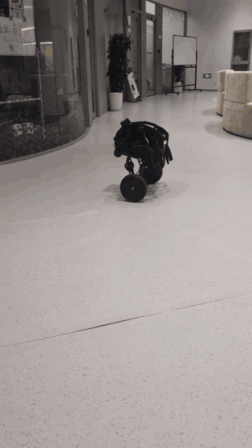
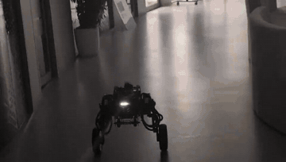
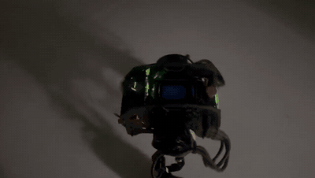
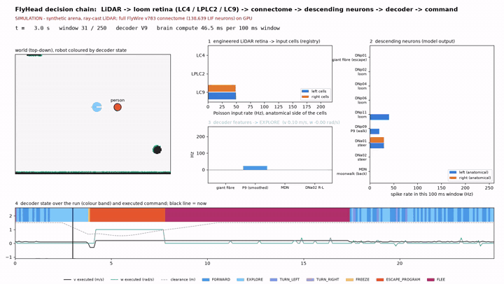
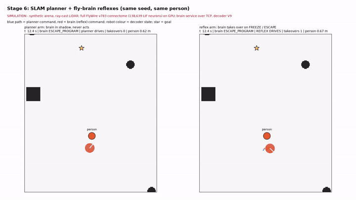
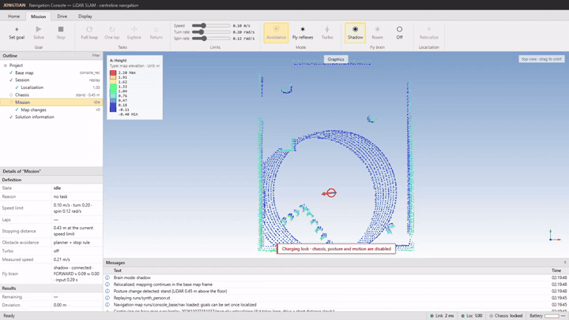

# 蝇首 FlyHead

**用完整果蝇连接组当轮足机器人"刑天"的头。**

刑天在神话里断首后仍继续作战；本项目给它装上一个果蝇的脑。

FlyHead 是一套研究用机器人系统，有两层决策，共用同一个机身：

1. **自主导航（不经过果蝇脑）。** 机器人用激光雷达 SLAM 建图，在保存的地图上重定位，并执行路线：
   目标点、探索、环形巡逻、返回充电、以及更快的 Turbo 模式。这一层可以独立运行，果蝇脑建立在它之上。
2. **果蝇脑。** 完整的 FlyWire v783 果蝇连接组（138639 个漏电积分发放神经元、15091983 条连接记录，
   PyTorch/CUDA）接收编码后的 LiDAR 逼近信号，通过已鉴定的下行神经元决定逃逸、转向和行走。
   它的输出只经过一个安全包络，包络只能减速或归零命令，不能增加运动。

硬件：DIABLO 轮足机器人（树莓派 4B、ROS 2 Foxy、Unitree L1 激光雷达）、GPU 计算主机和 Windows 操作员电脑。
SLAM、导航和大脑都运行在计算主机上；机器人只负责 I/O。

[English](README.md) · [演示](docs/demo.md) · [架构](docs/architecture.md) ·
[复现](docs/reproduce.md) · [验证](docs/verification.md) · [实验](experiments/README.md)

*神话注：刑天断首后仍然战斗。这里果蝇的脑就是头。*

---

## 目录

1. [视频](#视频)
2. [系统概览](#系统概览)
3. [什么是真实的、什么是仿真的、什么只是主张](#什么是真实的什么是仿真的什么只是主张)
4. [自主导航](#自主导航不经过果蝇脑)
5. [果蝇脑](#果蝇脑)
6. [目前的结果](#目前的结果)
7. [验证与仿真](#验证与仿真)
8. [已知问题与未解决事项](#已知问题与未解决事项)
9. [目录结构](#目录结构)
10. [快速开始](#快速开始)
11. [安全](#安全)
12. [文档索引](#文档索引)
13. [致谢与许可](#致谢与许可)

---

## 视频

每段视频都标明了它是什么。**REAL（真实）** 是实体机器人。**SIM（仿真）** 是带有射线投射激光雷达的模拟世界，
大脑是 GPU 上的完整连接组。**CONSOLE（上位机回放）** 是真实的操作员控制台和控制服务器，输入合成的激光雷达回放，
大脑处于影子模式（显示决策但从不发送）。视频在 [`docs/media/`](docs/media) 中；[docs/demo.md](docs/demo.md) 页面给出每段视频对应的运行、
以及每个面板背后的代码和日志字段。

### 实体机器人

| 自主导航：走廊中的姿态与路线行驶（19 s） | 自主导航：夜间办公室，4 倍速（90 s） |
| --- | --- |
|  |  |
| [mp4](docs/media/real/hallway_posture_drive.mp4) | [mp4](docs/media/real/office_night_drive_4x.mp4) |

| 果蝇脑驱动、有人逼近：stage 5，运行 stage5_004（54 s） |
| --- |
|  |
| [mp4](docs/media/real/stage5_004_brain_drive_escape.mp4) |

大脑视频按手机录制时间（本地 22:57:17）与驱动窗口（22:53:38–22:58:03）对应。该次运行中，大脑发出了 30 次逃逸程序，
报告 0 次碰撞；两段导航视频展示的是没有大脑参与的平台。两段导航视频的文件时间戳为 2026-10-08，即导航栈重建的当天
（录制日期没有其他依据确认）。

### 仿真（合成场地，射线投射激光雷达）

| 逐窗口的决策链：有人逼近（25 s） | Stage 6：规划器（左）与果蝇反射（右）（44 s） |
| --- | --- |
|  |  |
| [mp4](docs/media/sim/decision_chain_person_front.mp4) · [截图](docs/media/sim/decision_chain_escape.png) | [mp4](docs/media/sim/stage6_planner_vs_reflex.mp4) · [截图](docs/media/sim/stage6_planner_vs_reflex.png) |

决策链展示激光雷达场景、写入 LC4/LPLC2/LC9 输入格的速率、下行神经元速率、解码器状态和实际执行的命令。
截图是 4.3 s 时的逃逸。Stage 6 是合成场地上的种子 1：大脑只在冻结或逃逸时接管。

### 操作员控制台（回放，大脑影子模式）

| 回放会话中的上位机，大脑影子模式（61 s） |
| --- |
|  |
| [mp4](docs/media/console/console_replay_brain_shadow.mp4) · [截图](docs/media/console/console_brain_shadow.png) |

未经修改的控制台，经 SSH 隧道连到服务器。影子模式显示大脑的实时状态（例如 `shadow · connected · TURN_LEFT`），但从不发送。
这段回放是合成的，大脑对本录制中走近的人反应较弱；逃逸行为见决策链视频和实体 stage 5 视频。

---

## 系统概览

```text
                 ┌────────────── 计算主机（GPU）──────────────────────────────────────┐
LiDAR + IMU ───► │ SLAM（KISS-ICP）─► 在保存地图上重定位 ─► 规划器 ─► 命令              │──► 机器人 ──► 轮子
 （机器人）       │        │                                 ▲        │              │   （0.3 s 租约）
                 │        └─► 虚拟视网膜 ─► 脑服务 ─────────┘ 反射    ▼              │
                 │            LC4/LPLC2/LC9 ─► 连接组（13.8 万 LIF）─► 解码器 ─► 安全包络
                 └─────────────────────────────────────────────────────────────────────┘
操作员电脑：网页控制台（启动 LiDAR、目标点、环线、Turbo、脑模式）── SSH 隧道 ──► 服务器
```

控制服务器从不加载 torch：它通过本地 TCP 与脑服务通信。编码器和解码器只依赖 NumPy，机器人桥不导入本包。
模块边界见 [docs/architecture.md](docs/architecture.md)。

---

## 什么是真实的、什么是仿真的、什么只是主张

| 层 | 是什么 | 不是什么 |
| --- | --- | --- |
| 连接组模型 | eonsystemspbc/fly-brain 固定提交的 LIF 模型，神经方程未改 | 标定过的果蝇；没有学习 |
| 刺激编码 | 工程代理：LiDAR 角扩张 → LC4/LPLC2，前方自由空间 → LC9 | 视网膜或生物视觉复原 |
| 神经元身份 | 精确 cell_type → root_id → 模型下标，注释文件 SHA 锁定（`configs/fly/loom_registry.json`） | 跨命名类型的同义合并 |
| 解码 | 下行神经元放电的固定公式（逃逸程序、转向、行走、休息） | 导航脚本或恒定速度 |
| 导航 | 经典 SLAM + 中心线规划 + 纯跟踪，不经过大脑也能工作 | 大脑的决策，或神经结果 |
| 执行 | 解码意图经安全包络、围栏、keep-in 后的命令 | 把规划器输出冒充为神经决策 |

解剖侧别、LiDAR 视野侧和机器人转向符号是三张独立的表。注册表明确标注视野→眼的对应和转向符号 **尚未标定**。

---

## 自主导航（不经过果蝇脑）

这一层本身完整，也是大脑模式为 **关闭** 时机器人运行的部分。

### 感知与机身模型

* **激光雷达：** 机器人上的 Unitree L1，以二进制帧经 SSH 标准输出流式传到计算主机。L1 朝后安装，因此机身沿激光雷达 −x 方向前进
  （`lidar_slam.BODY_YAW_DEG = 180`）。
* **IMU：** 200 Hz。用于会话开始时的重力校平，以及每帧扫描的去畸变。
* **参考点：** 所有规划和控制都以机器人的 **转向点** 为准，即原地转向时保持不动的点：位于激光雷达身后 0.11 m，
  由 47 次原地转向拟合得到（残差不到 1 cm）。若控制机身中心，每转 46° 就会有 0.45 m 的横向摆动。细节见
  [docs/navigation_method.md](docs/navigation_method.md)。
* **姿态：** 站立或蹲伏，由激光雷达离地图地面的高度判断。机器人自身的机体通过学习得到的自遮罩从扫描中去除。

### 建图与定位

* **建图会话：** *启动 LiDAR* 在计算主机上以子进程运行 KISS-ICP 里程计。只有 IMU 覆盖的扫描会被去畸变；否则等待一小段时间后
  不去畸变地处理。与保存地图的持续差异会作为带版本的障碍物变化（`added` / `removed`）提交，并进入规划。
* **保存的地图包**（`maps/<名称>/`）：`map.pgm` / `map.yaml`（0.05 m 栅格）、`map.ply`（保存的点云）、高度层
  （`floor.npy`、`obst_hmin/hmax.npy`、`obst_bins.npy`）和记录会话来源的 `MAP_INFO.json`。地图包 **不提交到本仓库**：
  它们是真实建筑的平面图。
* **重定位：** 新会话在基础地图上全局搜索自己的位姿（匹配度 ≥ 0.8，并对最好和次好的候选做比值检验）。操作员的位姿提示可以替代歧义检验，
  适用于距离提示 1 m、朝向 30° 以内的候选。未完成定位前拒绝导航；定位度 < 0.6 持续 1 s 会取消任务。
* **地图修正：** 行驶时用基础地图修正位姿。连续两次因幅度过大（0.3 m / 5°）而被拒绝、但对齐良好的修正会触发漂移告警；
  服务器随后取消任务并重新定位。

### 规划：中心线路径

路线沿自由空间的中心线走，因此两堵墙之间机器人两侧的距离相等，不会贴着一面墙走。

1. **净空** *d*：到最近的阻挡格或未知格的距离。
2. **中心线：** λ-中轴，λ = 0.8 m，使墙面的粗糙不会产生分支。只有 *d* ≥ 0.45 m 的格子计入。
3. **偏移比** *r* = *m* / (*m* + *d*)，其中 *m* 是到中心线的距离。
4. **A\*** 在 0.10 m 栅格上进行，8 连通、不切角。步进代价 1 + 39 *r*²；*d* < 0.45 m 的格子不进入（硬净空 = 0.35 m 机身半径 + 0.10 m）。
5. **平滑**限制在中心线带内，按 0.05 m 重采样，并保留每个点的曲率和净空。

**环线巡逻**（`compute_loop`）：中心线网络最外层的闭合回路作为环线运行，分支则以往返方式遍历。深度不超过 3 m 的分支被裁掉；
更深的分支保留为往返的支路。当前地图中，从常用起点出发的巡逻环线长 71 m。

### 沿路线行驶

已确定的路线不会按计时器重新规划，只有以下情况才会改变：

* **确认了路线上的新障碍物**（在未来 3 m 内离路线 0.40 m 以内，连续 3 个控制周期）：机器人最多靠近到 0.5 m，然后拼接一段
  **局部绕行**，每 3 s 最多重试一次；
* **机器人偏离路线超过 0.5 m 达 2 s：** 拼接一段短的 **归位** 路线；偏离超过 1.5 m 则停止任务。

进度采用有界窗口内的弧长投影，因此经过同一位置两次的路线不会跳变。**折返点**（往返的掉头）需要单独处理：机器人在原地转向，接上返程路线。
到达判定要求剩余弧长和终点距离都在 0.20 m（目标点）或 0.30 m（巡逻）以内。

### 控制（10 Hz）

* **门控：** 底盘状态缺失、位姿或障碍物层过期（> 3 s）、或定位度低，都会保持任务；连续 5 帧有效后恢复。
* **纯跟踪：** 前视距离 0.5 + 4 s × 速度（最多 1.0 m）。曲率 κ = 2 sin α / *L*。
* **速度：** 取以下各项的最小值：操作员上限、曲率上限、净空上限（路线净空 0.45 m 时半速，0.8 m 时全速）、0.5 × 剩余弧长、
  位姿龄上限和航向比例；然后限制为 κ·v ≤ ω_max。
* **原地转向：** 航向误差超过 50° 时先刹停，再以不超过 0.12 rad/s（上限 0.30）转向，直到误差小于 12°。
* **变化率限制**（相对上一条命令）：线速度 +0.10 / −0.20 m/s²，角速度 +0.8 / −1.2 rad/s²。

### 主机安全链

主机在底盘保护介入之前就会停车：

| 环节 | 规则 |
| --- | --- |
| 自由行程 | 沿路线扫过机身圆盘，检查到 2.5 m |
| 按行程限速 | 满足 *v* × 0.6 s + *v*² / (2 × 0.20 m/s²) ≤ 自由行程 − 0.35 m 的最大 *v* |
| 底盘保护 | < 0.15 m → 停车（机器人上只报告，由主机执行） |
| 失速 | 前进命令但 2 s 无运动 → 停车 |
| 受阻 | 8 s 无绕行 → 以 0.08 m/s 倒车最多 0.6 m（后方需畅通），等待 2 s，重新规划；同一位置 3 个周期后交给操作员 |
| 放弃 | 目标点任务受阻 60 s 后放弃；巡逻则等待 |

这些常数是按命令速度估算的，偏乐观：站立时机器人的实际运动是命令的 1.3–2 倍。它们尚未用实测停车距离替换。

### 操作员限制、环线与 Turbo

* **操作员上限：** `XT_MAX_V`（默认 0.30 m/s，不得超过 1.0）。转向速率和速度可在控制台的 *Limits* 组中实时调整。
* **环线：** 巡逻任务的 `laps` 为 1–20，每圈结束后从当前位姿重新规划。停止、人工接管、某圈失败或电量低于 15 % 都会结束整组。
  **Full loop** 打开设置对话框。
* **Turbo**（过检查单后执行，最高 1.0 m/s 实测）：弯前制动的速度曲线（弯道横向加速度 0.15 m/s²）、直道上学习的实测/命令速度增益、
  停车规则 0.8 s + *v*² / (2 × 0.5 m/s²)，以及随定位度缩放的速度（≥ 0.95 全速，≤ 0.85 降到 0.30 m/s）。

### 实测性能（2026-10-08，站立，在机器人上）

普通模式约 130 m 的调好环线（路线 126–135 m，每个设定速度一圈）：

| 设定速度 v_max | 路线 | 圈时 | 平均 | 实测峰值 | 跟踪 p95 / 最大 | 原地转向占比 | 绕行次数 |
|---|---|---|---|---|---|---|---|
| 0.30 | 126.5 m | 9.3 min | 0.23 m/s | 0.45 m/s | 0.17 / 0.35 m | 15 % | 0 |
| 0.40 | 131.0 m | 8.8 min | 0.25 m/s | 0.53 m/s | 0.20 / 0.34 m | 23 % | 0 |
| 0.50 | 135.0 m | 9.0 min | 0.25 m/s | 0.65 m/s | 0.33 / 0.48 m | 30 % | 0 |
| 0.60 | 135.2 m | 10.6 min | 0.21 m/s | 0.73 m/s | 0.44 / 0.72 m | 39 % | 6 |

普通模式下 0.40 m/s 是最快的一圈：更高时机器人会冲过弯道，航向误差超过 50°，并停下来原地转向。Turbo 在机器人上每种设置各跑一圈：

| 运行 | 路线 | 时间 | 实测峰值 | 跟踪 p95 / 最大 | 原地转向占比 | 绕行次数 |
|---|---|---|---|---|---|---|
| Turbo 0.6 | 131.8 m | 8.7 min | 0.67 m/s | 0.19 / 0.32 m | 29 % | 0 |
| Turbo 0.8 | 125.9 m | 8.4 min | 0.85 m/s | 0.28 / 0.46 m | 34 % | 0 |
| Turbo 1.0 | 128.0 m | 7.7 min | 0.95 m/s | 0.23 / 0.39 m | 27 % | 0 |

紧急停车（Turbo 车道，按 10 Hz 记录测得）：峰值 0.74 m/s → 停在 0.71 m；峰值 0.77 m/s → 1.76 s 内停在 0.81 m。Turbo 的预算是
1.0 m/s 时 2.15 m。Turbo 滑移事故见 [已知问题](#已知问题与未解决事项)。

### 控制台（操作员电脑）

控制台是运行在操作员电脑上的网页；控制服务留在计算主机上。顶部功能区有四个标签：

| 标签 | 作用 |
| --- | --- |
| **Home** | *Start LiDAR* / *End*（会话）、*Save map*、*Camera*、*Full loop*、*Reset runtime*、*Continue on base map* |
| **Mission** | *Set goal* / *Solve* / *Stop*、*Explore*、*Return*、速度与转向限制、*Avoidance*（规划器 + 停车规则）、*Fly reflexes*、*Turbo*、果蝇脑模式 *Shadow* / *Roam* / *Off*、*Relocalize* |
| **Drive** | *Start chassis* / *Stop chassis*、*Guard reset*、姿态（*Stand* / *Crouch*） |
| **Display** | 地图视图（*Top*、*Iso*、*Follow*、*Clear trail*）、地图变化（*Commit changes*、*Auto commit*） |

大纲树显示：基础地图、会话（激光雷达）、定位（定位度）、底盘（姿态与激光雷达高度）、任务（状态与原因）、地图变化和解决方案信息。
消息列表记录服务器抛出的每一条事件，包括命令被拒绝的原因。

### 地图与操作流程

1. **充电锁：** 会话默认锁定（`XT_CHASSIS_DISABLED=1`）。*启动 LiDAR* 会开始传感器流并定位；只有同时打开两个开关后才能运动。
2. **建图：** 手动驾驶一段会话覆盖建筑，然后 *Save map*。会话写入 `runs/<id>/`，包括 `map.ply`、`trajectory.csv`、`summary.json` 和 `navigation.jsonl`。
3. **导出：** `tools/export_session_map.py` 生成地图包（栅格、高度层、`MAP_INFO.json`）。`tools/correct_map.py` 和 `correction_draft.json` 记录人工清理的障碍物变化。
4. **导航：** 以 `XT_MAP=maps/<包>` 启动服务器，会话随后在该地图上继续。

覆盖度是主要限制：基础地图有大片未知区域时，超出已建图范围的重定位会失败（[docs/slam_history.md](docs/slam_history.md)）。

---

## 果蝇脑

### 流水线

| 步骤 | 位置 | 输出 |
| --- | --- | --- |
| 激光雷达 → 视网膜（`LidarRetinaV3`） | 计算主机，每次扫描 | LC4、LPLC2、LC9 各输入格在左右两侧的发放率（Hz） |
| 输入格 | GPU，按注册表顺序 | 连接组以泊松输入接收这些速率 |
| 连接组 | GPU，每个窗口 10 × 10 ms 块，状态持续 | 9 类读出神经元在左右两侧的脉冲计数 |
| 解码器（v1–v9） | 服务 | 状态和意图（*v*、*w*） |
| 包络 | 服务器 | 只减小或归零意图，不增加运动 |

窗口数据流：每 100 ms 一个窗口的速率和脉冲。早于 0.35 s 的意图，或基于早于 0.45 s 扫描计算的意图会被丢弃
（见 [docs/architecture.md](docs/architecture.md)）。

### 读出神经元与解码器状态

| 读出神经元 | 在解码器中的作用 |
| --- | --- |
| DNp01 | 巨纤维，逃逸触发 |
| DNp02、DNp04、DNp06、DNp11 | 对逼近有反应的下行神经元 |
| DNp09 | P9，前进行走 |
| DNa01、DNa02 | 转向；DNa02 右减左决定转向 |
| MDN | 月球步，后退 |

解码器状态：**FORWARD**（前进）、**EXPLORE**（探索）、**TURN_LEFT** / **TURN_RIGHT**（左右转）、**HOLD**（保持）、
**REST**（休息）、**FREEZE**（冻结）、**ESCAPE_PROGRAM**（逃逸程序）、**BACK_OFF**（后退）、**FLEE**（逃跑）。
解码器 v9（最新运行所用）增加了内源性探索驱动和更长的逃跑。

### 大脑模式

| 模式 | 大脑做什么 | 使用于 |
| --- | --- | --- |
| `off` | 不做任何事，只用经典导航 | 默认 |
| `shadow` | 在实时扫描上运行，记录意图，不发送任何命令 | stage 4 |
| `drive`（控制台 *Roam*） | 意图 → 包络 → 地理围栏 / keep-in → 常规 0.3 s 租约；大脑直接驱动机器人 | stage 5 |
| `reflex` | 规划器驱动；大脑只在冻结或逃逸时接管，之后任务围绕一个禁入圆盘重新规划 | stage 6 |

### 神经元注册表

`configs/fly/loom_registry.json` 按精确的 `cell_type`、`root_id` 和模型下标，为 FlyWire 783 绑定每个输入和读出格（注释 TSV 的 SHA-256 为
`9a4f8b2f…`）。用 `tools/build_registry.py` 重建，并已在全新克隆中验证（513 个格，完全一致）。下标不能移植到其他版本的连接组。

---

## 目前的结果

所有数字都来自 [`experiments/`](experiments/README.md) 中的记录实验。

* **真实机器人上的逼近 → 逃逸**（stage 4/5，仅用激光雷达）：影子模式下，对 9 次操作员逼近的反应时间为 0.0–0.33 s；驱动模式下，
  逼近到逃逸决策的中位数为 0.35 s（0.09–1.08 s；`stage5_003` 中有 4/12 次未触发）。侧向逼近会让机器人转向远离较强的巨纤维一侧（最多约 100°），
  正面逼近则使机器人后退。凡操作员报告有接触的驱动，都是 0 次碰撞。激光雷达 → 机身 → 视网膜 → 大脑 → 解码器的整条链路中没有左右颠倒。
* **大脑耗时：** 在共享的 RTX 5090D 上，每 100 ms 窗口 84–110 ms GPU 时间（0.9–1.2× 实时）。空闲 GPU 上的复现测得每窗口 46 ms（约 2.2× 实时）。
* **Stage 1 复现：** 从全新克隆出发，629 个记录速率全部一致（[docs/verification.md](docs/verification.md)）。
* **闭环仿真：** stage 6（规划器 + 果蝇反射）在 `stage6_003` 中通过；stage 3 在一个场景上正式未通过，原因是已知的评估缺陷（person_right）。
* **EEG → DNa02**（离线）：24/24 个校准条件的转向方向都符合预期。这验证的是一条直接的运动节点通路，不是"果蝇理解了 EEG"。

---

## 验证与仿真

* **单元测试**（任何机器）：注册表一致性、视网膜、解码器、EEG 编码器、安全包络、合成场地（`pytest`，11 项）。
* **盲仿真**（无需 GPU）：`loom_sim` 的恒定前进基线。
* **大脑在环**（GPU）：`loom_sim … brain`、Stage 1 复现（`tools/repro_stage1.py`）、stage 3 套件（`experiments/loom_005/stage3_eval7.py`），以及 stage 6（`reflex_sim` 配合脑服务）。
* **不接机器人的控制服务器：** `tools/make_synthetic_raw.py` 生成激光雷达 + IMU 录制；`flyhead.server.app --replay` 把它送入服务器、SLAM 和脑连接。
* **上位机回放：** 同一份回放驱动操作员控制台，包括大脑影子模式的显示。

从全新克隆重跑的内容和结果见 [docs/verification.md](docs/verification.md)。未覆盖的部分：实体机器人上的 `robot/`，以及依赖私有录制地图的数值。

---

## 已知问题与未解决事项

以下是我们已知的问题，来自记录的实验和本仓库自己的检查。它们都不是仓库迁移导致的回归：导航、SLAM 和重定位代码与归档版本相比只改了导入路径，
同一张地图上归档版与仓库版的阶段 6 仿真结果一致。

| 问题 | 状态 |
| --- | --- |
| **Turbo 滑移（2026-10-08，实体机器人）。** 以约 0.75 m/s 并伴随转向时，位姿滑移约 0.5 m；正确的修正被 0.3 m 的修正上限拒绝，机器人滑行约 0.9 m。 | 已缓解（Turbo 弯道限制、随定位度缩放的速度、漂移告警）。根因未查明，是离线无法复现的实时事件。 |
| **修正上限。** 地图修正 0.3 m / 5° 的上限在 Turbo 滑移中拒绝了一个正确的 0.41 m 修正。 | 开放的设计问题；漂移告警是补偿措施。 |
| **停车距离。** 主机的安全常数是按命令速度估算的；站立时机器人的实际运动是命令的 1.3–2 倍。 | 开放；尚未用实测停车距离替换。 |
| **Keep-in 与围栏超调**（站立时）。若干 stage-5 判据因 0.05–0.2 m 而未通过。 | 开放。 |
| **人附近的反射/规划振荡；没有内在的行走驱动。** | 开放。 |
| **阶段 6 在真实场地地图上的运行。** 同一份代码、同一个种子，一次超时，一次到达。 | 实时仿真的运行差异，原因未查明。 |
| **合成录制的重定位。** 按场地栅格生成的录制与保存的点云对不上（约 60 % 的墙面点能对上），因此无法在该地图上重定位。 | 测试数据的限制；真实录制不受影响。 |
| **机器人端代码不在本仓库中。** 底盘驱动的改动（只报告的 guard、姿态准入）位于机器人的 `~/diablo_ws`；自动建图驱动（"scheme A"）只存在于计算服务器的脚本中。 | 开放的仓库缺口；`robot/` 不能保证与机器人上运行的代码一致。 |
| **许可证。** FlyHead 自身代码尚未选定许可证。 | 开放；目前保留所有权利。 |

---

## 目录结构

| 路径 | 作用 | 运行位置 |
| --- | --- | --- |
| [`flyhead/fly/`](flyhead/fly) | 果蝇：连接组模型、编码器（LiDAR 逼近、EEG）、解码器、脑服务 | GPU 主机 |
| [`flyhead/slam/`](flyhead/slam) | SLAM：KISS-ICP 里程计、重定位、地图层、原始录制 | 计算主机 |
| [`flyhead/navigation/`](flyhead/navigation) | 路线规划、跟踪、主机停车 / 限速 / 绕行链 | 计算主机 |
| [`flyhead/server/`](flyhead/server) | 服务端：经 SSH 管理机器人会话、控制环、脑连接 | 计算主机 |
| [`flyhead/safety/`](flyhead/safety) | 命令安全包络（只减速或归零） | 计算主机 |
| [`flyhead/sim/`](flyhead/sim) | 仿真环境：闭环仿真、合成场地、报告 | 任意（大脑需要 GPU） |
| [`flyhead/monitor/`](flyhead/monitor) | 监视器：操作员网页控制台 + SSH 隧道 | 操作员电脑 |
| [`robot/`](robot) | 机器人部署：ROS 2 桥（LiDAR、IMU、底盘、姿态），独立运行 | 机器人（树莓派 4B、ROS 2 Foxy） |
| [`experiments/`](experiments/README.md) | 各阶段协议、锁定结果和实际执行的脚本 | — |
| [`docs/`](docs) | 架构、复现、验证、演示、SLAM 运维、导航 | — |
| `configs/`、`scripts/`、`tools/`、`tests/` | 神经元注册表、启动脚本、地图工具、渲染器、单元测试 | — |

---

## 快速开始

### 任何机器：单元测试与盲仿真

```bash
git clone https://github.com/12sqawdwq/FlyHead.git && cd FlyHead
python -m venv .venv && . .venv/bin/activate        # Windows：.venv\Scripts\activate
pip install -e ".[dev]" && pytest
python -m flyhead.sim.loom_sim person_front blind 25 runs/blind.jsonl
python -m flyhead.sim.report runs/blind.jsonl
```

### 有 CUDA GPU（≥ 16 GB 空闲）：连接组在环

```bash
pip install -e ".[brain]"
python scripts/fetch_upstream.py                    # 固定版本的 fly-brain 代码 + FlyWire v783，校验身份
python tools/repro_stage1.py runs/repro_stage1      # Stage 1：与归档记录逐值比较
python -m flyhead.sim.loom_sim person_front brain 25 runs/brain.jsonl --decoder 9
```

### 演示渲染

```bash
pip install -e ".[demo]"
python tools/render_demo.py decision runs/decision.mp4 runs/brain.jsonl     # 决策链
python tools/render_demo.py reflex runs/stage6.mp4 runs/planner.jsonl runs/reflex.jsonl
```

### 机器人与控制服务器

完整流程见 [docs/reproduce.md](docs/reproduce.md)（第 2b 节和第 4 节）与 [docs/slam_operations.md](docs/slam_operations.md)。简要如下：

```bash
# 计算主机
XT_ROBOT_HOST=robot XT_ROBOT_ROOT=/home/<用户>/FlyHead XT_MAP=maps/<包> bash scripts/start_server.sh
bash scripts/start_brain_service.sh live_001        # 可选，用于大脑模式
# 操作员电脑
XT_COMPUTE_HOST=<别名> python flyhead/monitor/preview.py
```

实体运动需要在服务器启动时设置 `XT_CHASSIS_DISABLED=0 XT_REMOTE_MOTION_ENABLED=1`，机器人桥也会执行相同的两个互锁。

---

## 安全

实体运动需要在计算主机和机器人两端各自明确开启两个选项（`XT_CHASSIS_DISABLED=0`、`XT_REMOTE_MOTION_ENABLED=1`）；默认是充电锁。

| 机制 | 位置 | 行为 |
| --- | --- | --- |
| 命令租约 | 服务器 → 机器人桥 | 每个速度命令在机器人时钟上有 ≤ 0.3 s 的截止时间 |
| 保活 | 机器人桥 | 2 s 无服务器流量即归零运动 |
| 断链回放 | 机器人桥 | 10 s 无通信后，把实际执行的轨迹倒放（≤ 0.20 m/s，≤ 60 m） |
| 激光雷达看门狗 | 机器人桥 | 5 s 无扫描即归零运动并重启激光雷达节点（最多 4 次） |
| 新鲜度 | 导航 | 位姿或障碍物层过期（> 3 s）则保持任务 |
| 定位 | 导航 | 定位度 < 0.6 持续 1 s 即取消任务 |
| 主机停车链 | 导航 | 障碍物 ≤ 0.35 m 停车，< 0.70 m 减速；然后绕行；然后倒车等待 |
| 电池 | 服务器 | < 25 % 警告；< 15 % 停止导航、蹲下、拒绝新任务 |
| 大脑包络 | 服务器 | 意图只能减小或归零；围栏和 keep-in 在租约之前生效 |

命令 0.3 s 后过期，速度上限默认 0.30 m/s；任何驱动期间都应有遥控监督员。这是研究代码。见 [已知问题](#已知问题与未解决事项)。

---

## 文档索引

| 文档 | 内容 |
| --- | --- |
| [docs/demo.md](docs/demo.md) | 每段视频：对应的运行、每个面板背后的代码和日志字段、如何重新生成 |
| [docs/architecture.md](docs/architecture.md) | 机器、进程、模块边界、每个窗口的数据流 |
| [docs/reproduce.md](docs/reproduce.md) | 四个层级的复现，从单元测试到实体机器人 |
| [docs/verification.md](docs/verification.md) | 从全新克隆重跑的内容和结果 |
| [docs/navigation_method.md](docs/navigation_method.md) | 导航：参考点、规划、跟踪、控制、Turbo、滑移事故 |
| [docs/slam_operations.md](docs/slam_operations.md) | 主机、互锁、接口、地图包、部署、故障排查 |
| [docs/slam_history.md](docs/slam_history.md) | SLAM 与导航工作的历史和未解决事项 |
| [experiments/README.md](experiments/README.md) | 每个实验：协议、锁定结果、实际执行的脚本 |

---

## 致谢与许可

* 连接组模型：[eonsystemspbc/fly-brain](https://github.com/eonsystemspbc/fly-brain)（GPL-2.0），按固定提交获取，本仓库不再分发。
* 连接组与注释：FlyWire（Dorkenwald 等 2024、Schlegel 等 2024；[flyconnectome/flywire_annotations](https://github.com/flyconnectome/flywire_annotations)）。
* 激光雷达里程计：[KISS-ICP](https://github.com/PRBonn/kiss-icp)。网页控制台：[three.js](https://threejs.org)（MIT，随附许可证）。

FlyHead 自身代码尚未选定许可证；在添加之前，作者保留所有权利。

**话题：** connectome · flywire · drosophila · spiking neural network · LIF · neurorobotics · embodied AI · ROS 2 · LiDAR · looming · escape behaviour · SLAM · navigation · EEG · brain-computer interface · PyTorch · CUDA
