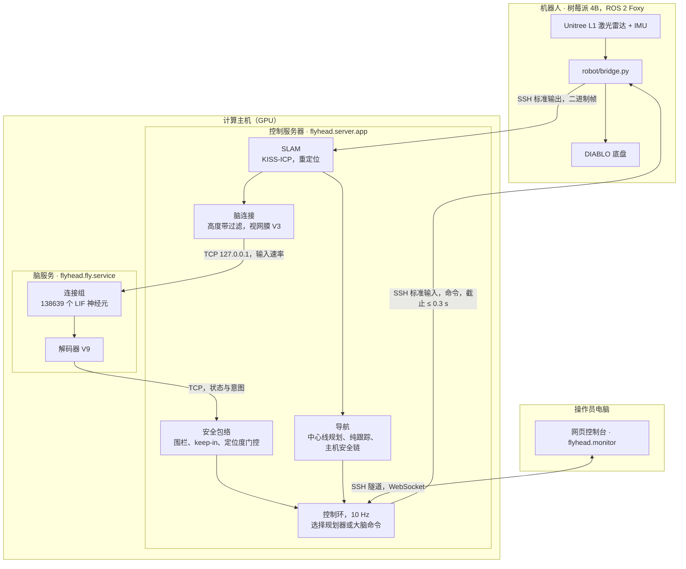
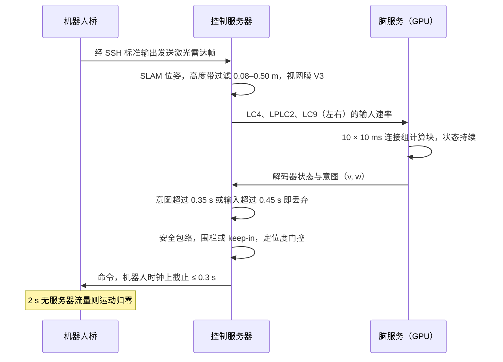

<div align="center">


<p>


</p>

<p>
<a href="README.md">English</a> · <b>中文</b> ·
<a href="#1-演示">演示</a> ·
<a href="#2-状态全景">状态全景</a> ·
<a href="#11-快速开始">快速开始</a> ·
<a href="docs/demo.md">演示页</a> ·
<a href="docs/architecture.md">架构</a> ·
<a href="docs/verification.md">验证</a> ·
<a href="experiments/README.md">实验</a>
</p>

</div>

FlyHead 是一台研究用机器人，**一个机身上有两层决策**：

| | |
| --- | --- |
| **自主导航** | 在建筑的已保存地图上做激光雷达 SLAM，中心线路径规划、巡逻、绕行和主机安全链。不需要大脑也能独立工作。 |
| **果蝇脑** | GPU 上的完整 FlyWire v783 果蝇连接组，把激光雷达的逼近信号经已鉴定的下行神经元转化为逃逸、转向和行走。安全包络只能减速或归零它的命令。 |

硬件：DIABLO 轮足机器人（树莓派 4B、ROS 2 Foxy、Unitree L1 激光雷达）、GPU 计算主机和 Windows 操作员电脑。
*刑天在神话里断首后仍继续作战；本项目给它装上一个果蝇的脑。*

---

## 1. 演示

<p>
 实体机器人（手机拍摄） &nbsp;
 机器人自身日志的回放 &nbsp;
 真实建筑的已保存 SLAM 地图 &nbsp;
 仿真激光雷达，GPU 上的完整连接组 &nbsp;
 真实控制台与服务器，回放会话
</p>

### 1.1 实体机器人

<table>
<tr>
<td width="50%" valign="top">

<p> <b>视频 1.</b> <b>自主导航 · 走廊</b></p>
<p><sub>站立 / 蹲伏姿态与路线行驶，无果蝇脑 · 19 s · <a href="docs/media/real/hallway_posture_drive.mp4">mp4</a></sub></p>
</td>
<td width="50%" valign="top">

<p> <b>视频 2.</b> <b>自主导航 · 夜间办公室</b></p>
<p><sub>在已建图的办公室中按路线行驶，无果蝇脑 · 6 分钟，4 倍速 · <a href="docs/media/real/office_night_drive_4x.mp4">mp4</a></sub></p>
</td>
</tr>
<tr>
<td width="50%" valign="top">

<p> <b>视频 3.</b> <b>果蝇脑驱动 · stage5_004</b></p>
<p><sub>有人逼近；大脑驱动 262 s，30 次逃逸程序，报告 0 次碰撞 · <a href="docs/media/real/stage5_004_brain_drive_escape.mp4">mp4</a></sub></p>
</td>
<td width="50%" valign="top">

<p> <b>视频 4.</b> <b>自主巡逻，按机器人日志回放</b></p>
<p><sub>2026-10-04 · 729 s，56.1 m，定位度 ≥ 0.963 · <a href="docs/media/realmap/real_tour_729s.mp4">mp4</a> · <a href="docs/media/realmap/real_tour_138s.mp4">138 s 巡逻</a></sub></p>
</td>
</tr>
</table>

### 1.2 真实场地：SLAM 地图

<table>
<tr>
<td width="50%" valign="top">

<p> <b>视频 5.</b> <b>建图会话回放</b></p>
<p><sub>2026-09-25 · 1407 s，54.7 m，550975 个点 · <a href="docs/media/realmap/slam_map_build.mp4">mp4</a></sub></p>
</td>
<td width="50%" valign="top">

<p> <b>视频 6.</b> <b>保存的三维点云</b></p>
<p><sub>1.3 m 以下的墙体与家具，按高度着色 · <a href="docs/media/realmap/slam_map_orbit.mp4">mp4</a></sub></p>
</td>
</tr>
</table>

<a href="docs/media/realmap/nav_layers.png"></a>

**图 1.** 已保存 SLAM 地图的导航图层：占据栅格 · 净空场与所有路线遵循的中心线 · 障碍物高度（什么会挡住蹲伏或站立的机器人）· 建图路径与真实巡逻。

### 1.3 真实地图上的果蝇脑

<table>
<tr>
<td width="50%" valign="top">

<p> <b>视频 7.</b> <b>逐窗口的决策链</b></p>
<p><sub>人从左侧逼近：激光雷达 → LC4/LPLC2/LC9 → 下行神经元 → 解码器 → 命令 · <a href="docs/media/realmap/decision_person_left.mp4">mp4</a></sub></p>
</td>
<td width="50%" valign="top">

<p> <b>视频 8.</b> <b>120 s 自由漫游</b></p>
<p><sub>18.9 m，0 次碰撞；一次运行中出现探索、逃逸、逃跑、冻结和保持 · <a href="docs/media/realmap/decision_roam_open.mp4">mp4</a></sub></p>
</td>
</tr>
<tr>
<td width="50%" valign="top">

<p> <b>视频 9.</b> <b>Stage 6：规划器与果蝇反射</b></p>
<p><sub>两组都以 0 碰撞到达；大脑接管两次 · <a href="docs/media/realmap/stage6_planner_vs_reflex.mp4">mp4</a></sub></p>
</td>
<td width="50%" valign="top">

<p> <b>视频 10.</b> <b>真实地图上的操作员控制台</b></p>
<p><sub>定位度 1.00 重定位，大脑影子模式，充电锁开启 · <a href="docs/media/realmap/console/console_real_map_brain_shadow.mp4">mp4</a></sub></p>
</td>
</tr>
</table>

### 1.4 真实地图上的全部八个大脑场景

| 场景 | 发生了什么 | 大脑：碰撞、最小净空 | 盲基线：碰撞 | 视频 |
| --- | --- | --- | --- | --- |
| `person_front` | 一个人走向机器人，在 0.7 m 处停下 | 0，0.69 m | 0 | [mp4](docs/media/realmap/decision_person_front.mp4) |
| `person_left` | 同上，从左侧 | 0，0.70 m | 0 | [mp4](docs/media/realmap/decision_person_left.mp4) |
| `person_right` | 同上，从右侧 | 0，0.56 m | 0 | [mp4](docs/media/realmap/decision_person_right.mp4) |
| `wall_ahead` | 沿通道驶向远处的墙 | 0，0.88 m | 0 | [mp4](docs/media/realmap/decision_wall_ahead.mp4) |
| `roam_open` | 120 s 自由漫游 | 0，0.45 m | 0 | [mp4](docs/media/realmap/decision_roam_open.mp4) |
| `loom_front` | 以 0.6 m/s 运动、永不停下的物体（压力测试） | 37，−0.23 m | 19 | [mp4](docs/media/realmap/decision_loom_front.mp4) |
| `loom_left` | 同上，从左侧 | 21，−0.23 m | 19 | [mp4](docs/media/realmap/decision_loom_left.mp4) |
| `loom_right` | 同上，从右侧 | 21，−0.23 m | 19 | [mp4](docs/media/realmap/decision_loom_right.mp4) |

`loom_*` 物体无论机器人做什么都会穿过它：大脑会逃逸，但物体一直跟着。这些场景统计碰撞，不算通过。

<a href="docs/media/realmap/scenarios_brain_vs_blind.png"></a>

**图 2.** 真实 SLAM 地图上的每个场景：果蝇脑的路径按解码器状态着色，盲基线为虚线，人或物体的轨迹为橙色；每次运行的碰撞数与最小净空。

<a href="docs/media/realmap/decoder_states.png"></a>

**图 3.** 每次大脑运行中解码器状态随时间的变化（真实地图上的仿真，解码器 V9）。


### 1.5 控制台的四个标签页

<table>
<tr>
<td width="50%" valign="top"><a href="docs/media/realmap/console/tab_home.png"></a><br><sub><b>Home</b> · 会话、地图、巡逻</sub></td>
<td width="50%" valign="top"><a href="docs/media/realmap/console/tab_mission.png"></a><br><sub><b>Mission</b> · 目标、限制、大脑模式</sub></td>
</tr>
<tr>
<td width="50%" valign="top"><a href="docs/media/realmap/console/tab_drive.png"></a><br><sub><b>Drive</b> · 底盘、姿态</sub></td>
<td width="50%" valign="top"><a href="docs/media/realmap/console/tab_display.png"></a><br><sub><b>Display</b> · 视图、地图变化</sub></td>
</tr>
</table>

控制台和服务器是真实的；会话是一段回放，扫描沿脚本路径从保存的点云生成，并加入了一个人。画面显示：重定位、姿态（站立，激光雷达 0.45 m）、
人被提交为地图变化，以及大脑的影子决策（HOLD、EXPLORE、TURN_LEFT/RIGHT、REST、FORWARD）。

### 1.6 各段素材的来源

* 大脑视频按手机录制时间（本地 22:57:17）与驱动窗口（22:53:38–22:58:03）对应。两段导航视频的文件时间戳为 2026-10-08，即导航栈重建的当天。
* 巡逻回放由实体机器人的控制台观测日志（`standing_tour_*_20261004*.jsonl`）渲染：每一帧是一条记录下来的导航消息。它们运行的是
  2026-10-04 的导航栈，比重建早四天。

  | 巡逻 | 行驶距离 | 导航状态（消息数） | 定位度 |
  | --- | --- | --- | --- |
  | 729 s | 56.1 m | driving 454、waiting 68、stopped 11、avoiding 5、planning 1 | 最低 0.963，中位 0.995 |
  | 138 s | 12.6 m | driving 104、idle 26、waiting 8、stopped 4、planning 1 | 最低 0.910，中位 0.995 |

* 地图于 2026-09-25 建成（0.05 m 分辨率的 912 × 926 栅格），2026-10-05 人工清理。地图包本身不在仓库中；仓库里只有它的渲染视图，经场地所有者同意发布。
* Stage 6：规划器组 122.1 s 到达；反射组 139.7 s 到达，接管 2 次（大脑控制 39 个窗口）。同一种子的另一次运行在 180 s 超时，0 次碰撞。
* 早期合成场地素材：[决策链](docs/media/sim/decision_chain_person_front.mp4) · [stage 6](docs/media/sim/stage6_planner_vs_reflex.mp4) ·
  [上位机](docs/media/console/console_replay_brain_shadow.mp4)。
* 每项素材的数据来源和渲染器：[docs/demo.md](docs/demo.md)。

---

## 2. 状态全景

| 层 | 状态 | 出处 |
| --- | --- | --- |
| 导航（真实日志） | `driving`、`waiting`、`stopped`、`avoiding`、`planning`、`idle` | 视频 4（状态色带、机器人颜色） |
| 导航（仿真） | `driving`、`arrived`、反射保持 | 视频 9 |
| 导航门控 | 位姿过期（等待）、绕行（`avoiding`）、航点进度 | 视频 4（原因一行） |
| 定位 | 在保存的地图上重定位（定位度 1.00）；真实巡逻中的定位度 | 视频 10；视频 4 |
| 姿态 | 蹲伏、站立 | 视频 1、4、10 |
| 地图变化 | 提交新障碍物、清除临时障碍物 | 视频 4（方框）；视频 10（消息） |
| 解码器 | FORWARD、EXPLORE、TURN_LEFT、TURN_RIGHT | 视频 7、8 及所有场景 |
| 解码器 | FREEZE、ESCAPE_PROGRAM、BACK_OFF、FLEE | 视频 7、8；人与逼近场景；视频 3（实体机器人） |
| 解码器 | HOLD、REST | 视频 8（HOLD）；视频 10（HOLD、REST） |
| 大脑模式 | `off` | 视频 1、2、4 |
| 大脑模式 | `shadow` | 视频 9（规划器组）；视频 10 |
| 大脑模式 | `drive` | 视频 3（实体机器人） |
| 大脑模式 | `reflex` | 视频 9（反射组） |
| 安全 | 充电锁开启 | 视频 10 |
| 安全 | 包络削减大脑命令 | 决策视频面板 3（"envelope:"）；逼近场景、`person_right`、视频 8 |

---

## 3. 系统概览

### 3.1 部署结构



### 3.2 一个 100 ms 决策窗口



控制服务器从不加载 torch：它通过本地 TCP 与脑服务通信。编码器和解码器只依赖 NumPy，机器人桥不导入本包。
模块边界见 [docs/architecture.md](docs/architecture.md)。

---

## 4. 什么是真实的、什么是仿真的、什么只是主张

| 层 | 是什么 | 不是什么 |
| --- | --- | --- |
| 连接组模型 | eonsystemspbc/fly-brain 固定提交的 LIF 模型，神经方程未改 | 标定过的果蝇；没有学习 |
| 刺激编码 | 工程代理：LiDAR 角扩张 → LC4/LPLC2，前方自由空间 → LC9 | 视网膜或生物视觉复原 |
| 神经元身份 | 精确 cell_type → root_id → 模型下标，注释文件 SHA 锁定（`configs/fly/loom_registry.json`） | 跨命名类型的同义合并 |
| 解码 | 下行神经元放电的固定公式（逃逸程序、转向、行走、休息） | 导航脚本或恒定速度 |
| 导航 | 经典 SLAM + 中心线规划 + 纯跟踪，不经过大脑也能工作 | 大脑的决策，或神经结果 |
| 执行 | 解码意图经安全包络、围栏、keep-in 后的命令 | 把规划器输出冒充为神经决策 |

解剖侧别、LiDAR 视野侧和机器人转向符号是三张独立的表。注册表明确标注视野→眼的对应和转向符号 **尚未标定**。

---

## 5. 自主导航（不经过果蝇脑）

经典导航层可以独立运行，也是大脑模式为 `off` 时机器人所做的事。完整方法见 [docs/navigation_method.md](docs/navigation_method.md)，
运维见 [docs/slam_operations.md](docs/slam_operations.md)。

### 5.1 传感器与机身模型

| 项目 | 取值 | 说明 | 代码 |
| --- | --- | --- | --- |
| 激光雷达 | Unitree L1，约 10 Hz 点云 | 经 SSH 标准输出以二进制帧传输；朝后安装（机身前方 = 激光雷达 −x） | `robot/bridge.py`，`lidar_slam.BODY_YAW_DEG = 180` |
| IMU | 200 Hz | 会话开始时重力校平；逐帧去畸变 | `flyhead/slam/lidar_slam.py` |
| 参考点 | 转向点，位于激光雷达后方 0.11 m | 由 47 次原地转向拟合，残差 < 1 cm；取代原先位于其前方 0.56 m 的机身中心 | `nav.REFERENCE_BODY = (-0.11, -0.01)` |
| 机身占位 | 半径 0.35 m 的圆盘 | 以转向点为圆心；机器人宽 0.5–0.7 m | `envelope.BODY_R` |
| 姿态 | 蹲伏 / 站立 | 由激光雷达离地图地面的高度判断；学习得到的自遮罩去除自身回波 | `flyhead/slam/lidar_slam.py` |

### 5.2 建图与定位

| 阶段 | 方法 | 阈值 | 代码 |
| --- | --- | --- | --- |
| 里程计 | 子进程中的 KISS-ICP | 首帧取 2 s 点云；之后按 0.2 s 子点云批处理 | `flyhead/slam/slam_process.py` |
| 去畸变 | 按点插值 IMU 姿态 | 等待 IMU 覆盖，超时则不去畸变直接处理 | `lidar_slam.imu_deskew` |
| 重定位 | 在基础地图上全局搜索 | 接受：匹配度 ≥ 0.8 且最优/次优比 ≥ 1.3；提示：1 m、30° 以内 | `flyhead/slam/reloc.py`（`MIN_FIT`、`MIN_RATIO`） |
| 定位门控 | 未定位前拒绝导航 | 定位度 < 0.6 持续 1 s 取消任务 | `flyhead/navigation/nav.py` |
| 地图修正 | 行驶中用基础地图修正位姿 | 超过 0.3 m 或 5° 的修正被拒绝；连续两次对齐良好的拒绝触发漂移告警 | `lidar_slam.py`，`Session.check_drift` |
| 地图变化 | 与基础地图的持续差异 | ≥ 0.03 m² 持续 1.5 s → 提交为 `added` / `removed` | `flyhead/slam/navmap.py` |

**地图包**（`maps/<名称>/`，不提交；渲染图见 [第 1 节](#1-演示)）：

| 文件 | 内容 |
| --- | --- |
| `map.pgm`、`map.yaml` | 占据栅格，0.05 m 分辨率（0 占据、254 空闲、205 未知） |
| `map.ply` | 保存的点云 |
| `floor.npy` | 每格地面高度 |
| `obst_hmin.npy`、`obst_hmax.npy`、`obst_bins.npy` | 地面以上障碍物最低 / 最高点，16 个 0.15 m 高度分箱 |
| `MAP_INFO.json` | 坐标系定义、来源会话、谱系、栅格统计 |

### 5.3 路线规划（中心线路径）

| 步骤 | 定义 | 参数 |
| --- | --- | --- |
| 净空 *d* | 到最近阻挡格或未知格的距离 | — |
| 中心线 | 自由空间的 λ-中轴 | λ = 0.8 m；仅 *d* ≥ 0.45 m 的格子 |
| 偏移比 | *r* = *m* / (*m* + *d*)，*m* 为到中心线的距离 | 中心线上为 0，靠墙趋于 1 |
| 搜索 | 0.10 m 栅格上的 A\*，8 连通、不切角 | 步进代价 1 + 39 *r*²；*d* < 0.45 m 不进入 |
| 平滑 | 中心线带内的拉普拉斯平滑 | 按 0.05 m 重采样，保留曲率与净空 |
| 巡逻环线 | 中心线网络最外层回路，分支往返遍历 | 裁掉 ≤ 3 m 的分支；当前地图为 71 m 环线 |

### 5.4 路线跟踪

| 事件 | 条件 | 动作 |
| --- | --- | --- |
| 路线上出现新障碍物 | 离路线 0.40 m 内、前方 3 m、连续 3 个控制周期 | 靠近到 ≤ 0.5 m，拼接局部绕行（重试间隔 ≥ 3 s） |
| 偏离路线 | > 0.5 m 持续 2 s | 拼接前方 1.0–3.5 m 的归位路线 |
| 严重偏离 | > 1.5 m | 停止任务 |
| 折返点 | ±0.15 m 内航向变化 > 120° | 原地转向接上返程 |
| 到达 | 剩余弧长与终点距离 | ≤ 0.20 m（目标点），≤ 0.30 m（巡逻） |

### 5.5 控制环（10 Hz）

| 环节 | 规则 | 取值 |
| --- | --- | --- |
| 门控 | 底盘状态存在，位姿和障碍物层新鲜，定位度足够 | 过期 > 3 s 保持任务；连续 5 帧有效后恢复 |
| 纯跟踪 | 前视距离 0.5 + 4 s × 速度 | ≤ 1.0 m；κ = 2 sin α / *L* |
| 速度 | 取操作员上限、曲率上限、净空上限、0.5 × 剩余弧长、位姿龄上限中的最小值 | 路线净空 0.45 m 时半速，0.8 m 时全速；κ·v ≤ ω_max |
| 原地转向 | 航向误差 > 50° | 刹停，以 ≤ 0.12 rad/s（上限 0.30）转向，直到 < 12° |
| 变化率限制 | 相对上一条命令 | 线速度 +0.10 / −0.20 m/s²；角速度 +0.8 / −1.2 rad/s² |

### 5.6 主机安全链

| 环节 | 规则 |
| --- | --- |
| 自由行程 | 沿路线扫过机身圆盘，检查到 2.5 m |
| 按行程限速 | 满足 *v* × 0.6 s + *v*² / (2 × 0.20 m/s²) ≤ 自由行程 − 0.35 m 的最大 *v* |
| 底盘保护 | < 0.15 m → 停车（机器人上只报告，由主机执行） |
| 失速 | 前进命令但 2 s 无运动 → 停车 |
| 受阻 | 8 s 无绕行 → 以 0.08 m/s 倒车 ≤ 0.6 m，等待 2 s，重新规划；3 个周期后交给操作员 |
| 放弃 | 目标点任务受阻 60 s 后放弃；巡逻则等待 |

停车常数按命令速度估算；站立时机器人的实际运动是命令的 1.3–2 倍。

### 5.7 速度模式

| 模式 | 上限 | 弯道 | 停车规则 | 随定位度缩放 |
| --- | --- | --- | --- | --- |
| 普通 | `XT_MAX_V`（默认 0.30，非 Turbo 时 ≤ 0.40 m/s） | 前方 0.6 m 的曲率上限 | 0.6 s + *v*² / (2 × 0.20 m/s²)，按命令速度 | < 0.80 → 0.15 m/s |
| Turbo | 实测 1.0 m/s | 速度曲线 *v* ≤ √(0.15 m/s² / κ)，弯前制动 | 0.8 s + *v*² / (2 × 0.5 m/s²)，按实测速度 | ≥ 0.95 全速，≤ 0.85 降到 0.30 m/s |
| 多圈 | 1–20 圈，每圈重新规划 | — | 停止、人工接管、某圈失败或电量 < 15 % 结束整组 | — |

### 5.8 实测性能（2026-10-08，站立，实体机器人）

| 运行 | v_max | 路线 | 圈时 | 平均 | 实测峰值 | 跟踪 p95 / 最大 | 原地转向占比 | 绕行次数 |
|---|---|---|---|---|---|---|---|---|
| 普通 | 0.30 | 126.5 m | 9.3 min | 0.23 m/s | 0.45 m/s | 0.17 / 0.35 m | 15 % | 0 |
| 普通 | 0.40 | 131.0 m | 8.8 min | 0.25 m/s | 0.53 m/s | 0.20 / 0.34 m | 23 % | 0 |
| 普通 | 0.50 | 135.0 m | 9.0 min | 0.25 m/s | 0.65 m/s | 0.33 / 0.48 m | 30 % | 0 |
| 普通 | 0.60 | 135.2 m | 10.6 min | 0.21 m/s | 0.73 m/s | 0.44 / 0.72 m | 39 % | 6 |
| Turbo | 0.6 | 131.8 m | 8.7 min | — | 0.67 m/s | 0.19 / 0.32 m | 29 % | 0 |
| Turbo | 0.8 | 125.9 m | 8.4 min | — | 0.85 m/s | 0.28 / 0.46 m | 34 % | 0 |
| Turbo | 1.0 | 128.0 m | 7.7 min | — | 0.95 m/s | 0.23 / 0.39 m | 27 % | 0 |

| 紧急停车（Turbo 车道） | 实测峰值 | 停车距离 | 停车时间 |
| --- | --- | --- | --- |
| 第 1 次 | 0.74 m/s | 0.71 m | — |
| 第 2 次 | 0.77 m/s | 0.81 m | 1.76 s |

普通模式下 0.40 m/s 是最快的一圈；更高时机器人冲过弯道并停下原地转向。当晚的 Turbo 滑移事故见 [第 9 节](#9-已知问题与未解决事项)。

### 5.9 操作员控制台

| 标签 | 控件 |
| --- | --- |
| Home | Start LiDAR / End、Save map、Camera、Full loop、Reset runtime、Continue on base map |
| Mission | Set goal / Solve / Stop、Explore、Return、速度与转向限制、Avoidance、Fly reflexes、Turbo、大脑 Shadow / Roam / Off、Relocalize |
| Drive | Start / Stop chassis、Guard reset、Stand / Crouch |
| Display | Top / Iso / Follow / Clear trail、Commit changes、Auto commit |

| 大纲节点 | 显示 |
| --- | --- |
| Base map、Session | 已加载的地图；会话类型（实时 / 回放） |
| Localization | 重定位状态与定位度 |
| Chassis | 姿态与激光雷达高度 |
| Mission | 导航状态与原因 |
| Map changes | 已提交的变化版本 |

### 5.10 建图流程

| 步骤 | 操作 | 产出 |
| --- | --- | --- |
| 1 | 在充电锁下启动（`XT_CHASSIS_DISABLED=1`）；Start LiDAR | 传感器数据流，无运动 |
| 2 | 手动驾驶一段会话覆盖建筑；Save map | `runs/<id>/`：`map.ply`、`trajectory.csv`、`summary.json`、`navigation.jsonl` |
| 3 | `tools/export_session_map.py`；用 `tools/correct_map.py` 人工清理 | 含栅格、高度层、`MAP_INFO.json` 的地图包 |
| 4 | 以 `XT_MAP=maps/<包>` 启动服务器 | 会话在其上重定位并导航 |

---

## 6. 果蝇脑

### 6.1 每 100 ms 窗口的流水线

| 步骤 | 位置 | 输入 → 输出 | 参数 | 代码 |
| --- | --- | --- | --- | --- |
| 高度带过滤 | 服务器，每次扫描 | 世界点 → 地面以上 0.08–0.50 m 的点，机身坐标系 | 反射模式去掉距已建图障碍物 ≤ 0.20 m 的点 | `flyhead/server/brain_link.py` |
| 视网膜 V3 | 服务器 | 世界坐标中汇集 0.3 s 的点，24 个 15° 分箱 → 速率 | 物体宽度 0.30 m；逼近增益 600 Hz/(rad/s)；死区 0.12 rad/s；LC9 由前方 0.5–2.5 m 自由空间决定（≤ 120 Hz）；速率 ≤ 200 Hz | `flyhead/fly/encoders/lidar_loom.py` |
| 输入格 | GPU | 速率 → LC4、LPLC2、LC9（左 / 右）的泊松输入 | 注册表顺序；扫描过期（> 0.30 s）→ 输入为零 | `configs/fly/loom_registry.json` |
| 连接组 | GPU | 10 × 10 ms 块，状态持续 | 138639 个 LIF 神经元，15091983 条连接记录 | `flyhead/fly/model.py` |
| 读出 | GPU | 9 类神经元在左右两侧的脉冲计数 | DNp01、DNp02、DNp04、DNp06、DNp11、DNp09、DNa01、DNa02、MDN | `Brain.readouts_by_type` |
| 解码器 | 服务 | 速率 → 状态与意图（*v*、*w*） | V9（见下） | `flyhead/fly/decoders/loom.py` |
| 门控与包络 | 服务器 | 意图 → 命令 | 意图 > 0.35 s 或输入 > 0.45 s 即丢弃；定位度 ≥ 0.80（逃逸时 0.50）；包络只减速或归零 | `brain_link.py`，`flyhead/safety/envelope.py` |

### 6.2 读出神经元

| 读出 | 解码变量 | 参考速率 | 作用 |
| --- | --- | --- | --- |
| DNp09（P9） | 前进驱动 | 60 Hz → 0.15 m/s | 行走速度 |
| MDN | 后退驱动 | 35 Hz → 0.10 m/s | 后退 |
| DNa02 右 − 左 | 转向 | 20 Hz → 0.40 rad/s | 右侧大于左侧时右转（yaw < 0） |
| DNp01（巨纤维） | 逃逸触发 | 爆发 ≥ 60 Hz（V6 起）；≥ 100 Hz 使冻结升级 | 启动逃逸程序；方向由左右不对称决定 |
| DNp02、DNp04、DNp06、DNp11 | — | — | 记录，解码器不使用 |
| DNa01 | — | — | 诊断用（受前进驱动影响） |

### 6.3 解码器 V9 状态

| 状态 | 进入条件 | 命令 | 退出条件 |
| --- | --- | --- | --- |
| FORWARD / TURN_LEFT / TURN_RIGHT | 神经驱动超过阈值 | *v* 来自 DNp09 − MDN，*w* 来自 DNa02 | 驱动变化 |
| EXPLORE | 内源性行走段（20–45 s，固定种子）且神经 *v* < 0.10 m/s | *v* = 0.10 m/s，*w* 来自 DNa02 | 停顿段（4–12 s）或进入防御状态 |
| HOLD | 没有驱动超过阈值 | 停止 | 驱动恢复 |
| REST | 平滑后的 DNp09 < 8 Hz（行走段之外） | 停止 | DNp09 > 20 Hz |
| FREEZE | DNp09 < 15 Hz 时出现巨纤维爆发 | 停止 | 1.5 s 后或巨纤维 ≥ 100 Hz 时升级；巨纤维安静 2 s 后结束 |
| ESCAPE_PROGRAM | 巨纤维爆发 ≥ 60 Hz | 正面（\|asym\| < 0.30）：以 0.30 m/s 后退再转离；侧面：0.20 m/s 前进、1.0 rad/s 转离 | 程序 1.5 s（转向 2.5 s）；除非另一侧 \|asym\| ≥ 0.45，否则方向保持 |
| BACK_OFF | MDN 驱动超过前进驱动 | 后退 | 驱动变化 |
| FLEE | 逃逸程序之后 | 0.20 m/s，由 DNa02 转向 | 6 s + 4 s × 唤醒度，≤ 20 s |

EXPLORE 和唤醒度是解码器侧的工程补充，不是连接组活动；记录中保留 `neural_v`，以区分神经部分和内源部分。

### 6.4 大脑模式

| 模式 | 大脑作用 | 命令限制 | 使用于 |
| --- | --- | --- | --- |
| `off` | 无 | — | 默认 |
| `shadow` | 在实时扫描上运行；记录意图，从不发送 | — | stage 4 |
| `drive`（控制台：Roam） | 决定运动 | 前进 0.15 m/s、后退 0.10 m/s、0.40 rad/s；逃逸时 0.20 / 0.30 m/s、1.0 rad/s；地理围栏或地图 keep-in | stage 5 |
| `reflex` | 规划器驱动；FREEZE / ESCAPE_PROGRAM 时大脑接管，之后任务绕禁入区重新规划 | 大脑控制期间限制同 `drive` | stage 6 |

### 6.5 神经元注册表

| 项目 | 取值 |
| --- | --- |
| 文件 | `configs/fly/loom_registry.json` |
| 绑定方式 | 精确 `cell_type` → `root_id` → 模型下标 |
| 连接组 | FlyWire 783；注释 TSV 的 SHA-256 为 `9a4f8b2f…` |
| 格数 | 513（LC4 104、LPLC2 210、LC9 179、读出 20） |
| 重建 | `tools/build_registry.py`；全新克隆中结果一致 |
| 未标定 | 视野侧 → 眼、机器人转向符号 |

---

## 7. 目前的结果

| 结果 | 数值 | 来源 |
| --- | --- | --- |
| 实体机器人影子模式（stage 4） | 对 9 次操作员逼近的反应时间 0.0–0.33 s | `experiments/loom_005`，stage4_002 |
| 大脑驱动，逼近 → 逃逸决策（stage 5） | 中位 0.35 s（0.09–1.08 s）；12 次中 4 次未触发 | stage5_003 |
| 逃逸方向 | 侧向逼近时转离较强的巨纤维一侧（≤ 约 100°）；正面逼近时后退 | stage 5 各次运行 |
| 大脑驱动中的碰撞 | 凡操作员报告碰撞情况的驱动均为 0 | stage 5 各次运行 |
| 左右一致性 | 激光雷达 → 机身 → 视网膜 → 大脑 → 解码器无左右颠倒 | stage 4 |
| 每 100 ms 窗口的大脑耗时 | 共享 RTX 5090D 上 84–110 ms（0.9–1.2× 实时）；空闲 GPU 上 46 ms | stage 1；[验证](docs/verification.md) |
| Stage 1 复现 | 全新克隆中 629 / 629 个记录速率一致 | [验证](docs/verification.md) |
| Stage 3（闭环仿真） | 在 person_right 上正式未通过（已知评估缺陷） | stage3_002 – stage3_010 |
| Stage 6（规划器 + 反射，仿真） | stage6_003 通过 | `runs/stage6_003` |
| 真实地图仿真套件（V9） | 人、墙、漫游场景 0 碰撞；逼近压力测试 21–37 次碰撞 | [第 1.3 节](#13-真实地图上的果蝇脑) |
| EEG → DNa02（离线） | 24/24 个校准方向；33 次有效回放中 25 次与标签一致 | `experiments/eeg_dna02` |

EEG 结果验证的是一条直接的运动节点通路，不是"果蝇理解了 EEG"。

---

## 8. 验证与仿真

| 检查 | 方法 | 结果 |
| --- | --- | --- |
| 上游数据一致性 | `scripts/fetch_upstream.py --annotations` | 所有文件与固定的大小和 SHA-1 一致 |
| 神经元注册表 | 从注释 TSV 重建并比较 | 513 个格完全一致 |
| 单元测试 | `pytest`（也在仅装 `.[dev]` 的环境中） | 11 项通过 |
| 连接组，stage 1 | `tools/repro_stage1.py` 与归档记录比较 | 629 / 629 一致 |
| 重构等价性 | 实际执行的 `sim_brain.py` 与 `flyhead.sim.loom_sim`，3 个场景 × V4 / V9 | 366 / 366 个窗口一致（计时字段除外） |
| Stage 3 套件，V9，合成场地 | 5 个场景，大脑与盲基线 | 0 碰撞；C1、C2 通过；人场景因起点判定缺陷未通过 |
| 控制服务器与 SLAM | 合成录制经 `flyhead.server.app --replay` | 77 帧去畸变与校平，地图保存，无错误 |
| Stage 6，合成场地 | 2 组 × 3 个种子，配合脑服务 | STAGE 6 SIM PASSED |
| Stage 6，真实地图，归档代码与仓库代码 | 同一地图、同一种子 | 分别 139.6 s 与 139.7 s 到达，均 0 碰撞、2 次接管 |

细节见 [docs/verification.md](docs/verification.md)。未覆盖：实体硬件上的 `robot/`，以及依赖私有录制地图的数值。

---

## 9. 已知问题与未解决事项

以下是我们已知的问题，来自记录的实验和本仓库自己的检查。它们都不是仓库迁移导致的回归：导航、SLAM 和重定位代码与归档版本相比只改了导入路径，
同一张地图上归档版与仓库版的阶段 6 仿真结果一致。

| 问题 | 状态 |
| --- | --- |
| **Turbo 滑移（2026-10-08，实体机器人）。** 以约 0.75 m/s 并伴随转向时，位姿滑移约 0.5 m；正确的修正被 0.3 m 的修正上限拒绝，机器人滑行约 0.9 m。 | 已缓解（Turbo 弯道限制、随定位度缩放的速度、漂移告警）。根因未查明，是离线无法复现的实时事件。 |
| **修正上限。** 地图修正 0.3 m / 5° 的上限在 Turbo 滑移中拒绝了一个正确的 0.41 m 修正。 | 开放的设计问题；漂移告警是补偿措施。 |
| **停车距离。** 主机的安全常数是按命令速度估算的；站立时机器人的实际运动是命令的 1.3–2 倍。 | 开放；尚未用实测停车距离替换。 |
| **Keep-in 与围栏超调**（站立时）。若干 stage-5 判据因 0.05–0.2 m 而未通过。 | 开放。 |
| **人附近的反射/规划振荡；没有内在的行走驱动。** | 开放。 |
| **阶段 6 在真实场地地图上的运行。** 同一份代码、同一个种子，一次超时，一次到达。 | 实时仿真的运行差异，原因未查明。 |
| **合成录制的重定位。** 按场地栅格生成的录制与保存的点云对不上（约 60 % 的墙面点能对上），因此无法在该地图上重定位。 | 测试数据的限制；真实录制不受影响。 |
| **机器人端代码不在本仓库中。** 底盘驱动的改动（只报告的 guard、姿态准入）位于机器人的 `~/diablo_ws`；自动建图驱动（"scheme A"）只存在于计算服务器的脚本中。 | 开放的仓库缺口；`robot/` 不能保证与机器人上运行的代码一致。 |
| **永不停下的逼近物体（`loom_*` 压力测试）。** 在真实地图上大脑会逃逸，但物体一直跟随，`loom_front` 中的碰撞数比盲基线还多（37 对 19）。 | 开放：针对追赶物体的逃逸距离与方向。 |
| **许可证。** FlyHead 自身代码尚未选定许可证。 | 开放；目前保留所有权利。 |

---

## 10. 目录结构

| 路径 | 作用 | 运行位置 |
| --- | --- | --- |
| [`flyhead/fly/`](flyhead/fly) | 果蝇：连接组模型、编码器（LiDAR 逼近、EEG）、解码器、脑服务 | GPU 主机 |
| [`flyhead/slam/`](flyhead/slam) | SLAM：KISS-ICP 里程计、重定位、地图层、原始录制 | 计算主机 |
| [`flyhead/navigation/`](flyhead/navigation) | 路线规划、跟踪、主机停车 / 限速 / 绕行链 | 计算主机 |
| [`flyhead/server/`](flyhead/server) | 服务端：经 SSH 管理机器人会话、控制环、脑连接 | 计算主机 |
| [`flyhead/safety/`](flyhead/safety) | 命令安全包络（只减速或归零） | 计算主机 |
| [`flyhead/sim/`](flyhead/sim) | 仿真环境：闭环仿真、合成场地、报告 | 任意（大脑需要 GPU） |
| [`flyhead/monitor/`](flyhead/monitor) | 监视器：操作员网页控制台 + SSH 隧道 | 操作员电脑 |
| [`robot/`](robot) | 机器人部署：ROS 2 桥（LiDAR、IMU、底盘、姿态），独立运行 | 机器人（树莓派 4B、ROS 2 Foxy） |
| [`experiments/`](experiments/README.md) | 各阶段协议、锁定结果和实际执行的脚本 | — |
| [`docs/`](docs) | 架构、复现、验证、演示、SLAM 运维、导航 | — |
| `configs/`、`scripts/`、`tools/`、`tests/` | 神经元注册表、启动脚本、地图工具、渲染器、单元测试 | — |

---

## 11. 快速开始

### 11.1 任何机器：单元测试与盲仿真

```bash
git clone https://github.com/12sqawdwq/FlyHead.git && cd FlyHead
python -m venv .venv && . .venv/bin/activate        # Windows：.venv\Scripts\activate
pip install -e ".[dev]" && pytest
python -m flyhead.sim.loom_sim person_front blind 25 runs/blind.jsonl
python -m flyhead.sim.report runs/blind.jsonl
```

### 11.2 有 CUDA GPU（≥ 16 GB 空闲）：连接组在环

```bash
pip install -e ".[brain]"
python scripts/fetch_upstream.py                    # 固定版本的 fly-brain 代码 + FlyWire v783，校验身份
python tools/repro_stage1.py runs/repro_stage1      # Stage 1：与归档记录逐值比较
python -m flyhead.sim.loom_sim person_front brain 25 runs/brain.jsonl --decoder 9
```

### 11.3 演示渲染

```bash
pip install -e ".[demo]"
python tools/render_demo.py decision runs/decision.mp4 runs/brain.jsonl     # 决策链
python tools/render_demo.py reflex runs/stage6.mp4 runs/planner.jsonl runs/reflex.jsonl
```

### 11.4 机器人与控制服务器

完整流程见 [docs/reproduce.md](docs/reproduce.md)（第 2b 节和第 4 节）与 [docs/slam_operations.md](docs/slam_operations.md)。简要如下：

```bash
# 计算主机
XT_ROBOT_HOST=robot XT_ROBOT_ROOT=/home/<用户>/FlyHead XT_MAP=maps/<包> bash scripts/start_server.sh
bash scripts/start_brain_service.sh live_001        # 可选，用于大脑模式
# 操作员电脑
XT_COMPUTE_HOST=<别名> python flyhead/monitor/preview.py
```

实体运动需要在服务器启动时设置 `XT_CHASSIS_DISABLED=0 XT_REMOTE_MOTION_ENABLED=1`，机器人桥也会执行相同的两个互锁。

---

## 12. 安全

实体运动需要在计算主机和机器人两端各自明确开启两个选项（`XT_CHASSIS_DISABLED=0`、`XT_REMOTE_MOTION_ENABLED=1`）；默认是充电锁。

| 机制 | 位置 | 行为 |
| --- | --- | --- |
| 命令租约 | 服务器 → 机器人桥 | 每个速度命令在机器人时钟上有 ≤ 0.3 s 的截止时间 |
| 保活 | 机器人桥 | 2 s 无服务器流量即归零运动 |
| 断链回放 | 机器人桥 | 10 s 无通信后，把实际执行的轨迹倒放（≤ 0.20 m/s，≤ 60 m） |
| 激光雷达看门狗 | 机器人桥 | 5 s 无扫描即归零运动并重启激光雷达节点（最多 4 次） |
| 新鲜度 | 导航 | 位姿或障碍物层过期（> 3 s）则保持任务 |
| 定位 | 导航 | 定位度 < 0.6 持续 1 s 即取消任务 |
| 主机停车链 | 导航 | 障碍物 ≤ 0.35 m 停车，< 0.70 m 减速；然后绕行；然后倒车等待 |
| 电池 | 服务器 | < 25 % 警告；< 15 % 停止导航、蹲下、拒绝新任务 |
| 大脑包络 | 服务器 | 意图只能减小或归零；围栏和 keep-in 在租约之前生效 |

命令 0.3 s 后过期，速度上限默认 0.30 m/s；任何驱动期间都应有遥控监督员。这是研究代码。见 [已知问题](#9-已知问题与未解决事项)。

---

## 13. 文档索引

| 文档 | 内容 |
| --- | --- |
| `tools/render_real.py`、`tools/render_demo.py` | 所有图和视频的渲染器，输入为日志和地图包 |
| [docs/demo.md](docs/demo.md) | 每段视频：对应的运行、每个面板背后的代码和日志字段、如何重新生成 |
| [docs/architecture.md](docs/architecture.md) | 机器、进程、模块边界、每个窗口的数据流 |
| [docs/reproduce.md](docs/reproduce.md) | 四个层级的复现，从单元测试到实体机器人 |
| [docs/verification.md](docs/verification.md) | 从全新克隆重跑的内容和结果 |
| [docs/navigation_method.md](docs/navigation_method.md) | 导航：参考点、规划、跟踪、控制、Turbo、滑移事故 |
| [docs/slam_operations.md](docs/slam_operations.md) | 主机、互锁、接口、地图包、部署、故障排查 |
| [docs/slam_history.md](docs/slam_history.md) | SLAM 与导航工作的历史和未解决事项 |
| [experiments/README.md](experiments/README.md) | 每个实验：协议、锁定结果、实际执行的脚本 |

---

## 14. 致谢与许可

* 连接组模型：[eonsystemspbc/fly-brain](https://github.com/eonsystemspbc/fly-brain)（GPL-2.0），按固定提交获取，本仓库不再分发。
* 连接组与注释：FlyWire（Dorkenwald 等 2024、Schlegel 等 2024；[flyconnectome/flywire_annotations](https://github.com/flyconnectome/flywire_annotations)）。
* 激光雷达里程计：[KISS-ICP](https://github.com/PRBonn/kiss-icp)。网页控制台：[three.js](https://threejs.org)（MIT，随附许可证）。

FlyHead 自身代码尚未选定许可证；在添加之前，作者保留所有权利。

**话题：** connectome · flywire · drosophila · spiking neural network · LIF · neurorobotics · embodied AI · ROS 2 · LiDAR · looming · escape behaviour · SLAM · navigation · EEG · brain-computer interface · PyTorch · CUDA
