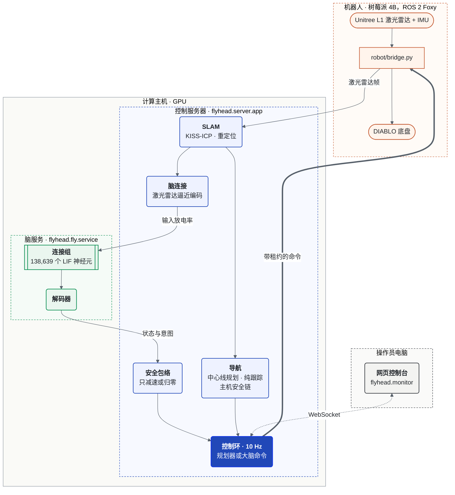

<div align="center">

<a href="https://flyhead.live/?lang=zh"></a>

<h3>在 GPU 上仿真一只果蝇的全脑连接组，驱动一台真实的轮足机器人。</h3>

<a href="https://flyhead.live/?lang=zh"></a>

<p>


</p>

<p>
<a href="README.md">English</a> · <b>中文</b> ·
<a href="https://flyhead.live/?lang=zh">官网</a> ·
<a href="#演示">演示</a> ·
<a href="#系统概览">系统</a> ·
<a href="#快速开始">快速开始</a>
</p>

<sub>上图是从官网录制的 3D 渲染，不是机器人实拍；实拍见下方。</sub>

</div>

## 果蝇脑驱动的实体机器人

<table>
<tr>
<td width="55%" valign="top">

<p> <sub>手机拍摄 · <a href="docs/media/real/stage5_004_brain_drive_escape.mp4">mp4</a></sub></p>
</td>
<td width="45%" valign="top">

**人走近时，激光雷达的逼近信号驱动已鉴定的视觉神经元，连接组产生响应，解码器再把下行神经元的活动读成运动。**

* **138,639** 个 LIF 神经元，**15,091,983** 条连接记录（FlyWire v783）
* 激光雷达逼近 → LC4 / LPLC2 / LC9 → 下行神经元（DNp01、DNa02、MDN）→ 逃逸、转向、行走
* 安全包络只能减速或归零大脑的命令

</td>
</tr>
</table>

刺激编码器和解码器是工程代理，不是果蝇视觉或运动控制的复原。

## 用 3D 探索

**点击卡片即可打开 [flyhead.live](https://flyhead.live/?lang=zh) 的对应章节**：滚动拆解机器人，拖动旋转视角，切换场景。

<table>
<tr>
<td width="33%" valign="top">
<a href="https://flyhead.live/?lang=zh#p=0.15"></a>
<p> <b><a href="https://flyhead.live/?lang=zh#p=0.15">拆开看</a></b></p>
<p><sub>厂商网格加示意零件；滚动即可拆解</sub></p>
</td>
<td width="33%" valign="top">
<a href="https://flyhead.live/?lang=zh#p=0.42"></a>
<p> <b><a href="https://flyhead.live/?lang=zh#p=0.42">真实建图的场地</a></b></p>
<p><sub>真实激光雷达建图得到的点云</sub></p>
</td>
<td width="33%" valign="top">
<a href="https://flyhead.live/?lang=zh#p=0.48"></a>
<p> <b><a href="https://flyhead.live/?lang=zh#p=0.48">带脑 vs 不带脑</a></b></p>
<p><sub>闭环仿真；挑选的场景，不是平均表现</sub></p>
</td>
</tr>
<tr>
<td width="33%" valign="top">
<a href="https://flyhead.live/?lang=zh#p=0.65"></a>
<p> <b><a href="https://flyhead.live/?lang=zh#p=0.65">一只果蝇的全脑</a></b></p>
<p><sub>FlyWire 真实坐标，只绘制部分抽样神经元</sub></p>
</td>
<td width="33%" valign="top">
<a href="https://flyhead.live/?lang=zh#p=0.81"></a>
<p> <b><a href="https://flyhead.live/?lang=zh#p=0.81">从脑区到动作</a></b></p>
<p><sub>仿真放电率与工程解码器；信号动画为示意</sub></p>
</td>
<td width="33%" valign="top">
<a href="https://flyhead.live/?lang=zh#p=0.915"></a>
<p> <b><a href="https://flyhead.live/?lang=zh#p=0.915">逐窗决策回放</a></b></p>
<p><sub>实机脑驱动窗口；挑选的片段，人形为示意</sub></p>
</td>
</tr>
</table>

## 一个机身，两层决策

| | |
| --- | --- |
| **自主导航** | 在建筑的已保存地图上做激光雷达 SLAM，中心线路径规划、巡逻、绕行和主机安全链。不需要大脑也能独立工作。 |
| **果蝇脑** | GPU 上的完整 FlyWire v783 果蝇连接组，把激光雷达的逼近信号经已鉴定的下行神经元转化为逃逸、转向和行走。安全包络只能减速或归零它的命令。 |

硬件：DIABLO 轮足机器人（树莓派 4B、ROS 2 Foxy、Unitree L1 激光雷达）、GPU 计算主机和 Windows 操作员电脑。
*刑天在神话里断首后仍继续作战；本项目给它装上一个果蝇的脑。*

---

## 演示

<p>
 实体机器人（手机拍摄） &nbsp;
 机器人自身日志的回放 &nbsp;
 真实建筑的已保存 SLAM 地图 &nbsp;
 仿真激光雷达，GPU 上运行完整连接组 &nbsp;
 真实控制台与服务器，回放会话
</p>

### 实体机器人

<table>
<tr>
<td width="50%" valign="top">

<p> <b>自主导航 · 走廊</b></p>
<p><sub>站立／蹲伏姿态与路线行驶，不使用果蝇脑 · <a href="docs/media/real/hallway_posture_drive.mp4">mp4</a></sub></p>
</td>
<td width="50%" valign="top">

<p> <b>自主导航 · 夜间办公室</b></p>
<p><sub>在已建图的办公室中按路线行驶，不使用果蝇脑 · 4 倍速 · <a href="docs/media/real/office_night_drive_4x.mp4">mp4</a></sub></p>
</td>
</tr>
<tr>
<td width="50%" valign="top">

<p> <b>果蝇脑驱动</b></p>
<p><sub>人走近，机器人逃开 · <a href="docs/media/real/stage5_004_brain_drive_escape.mp4">mp4</a></sub></p>
</td>
<td width="50%" valign="top">

<p> <b>自主巡逻，来自机器人日志</b></p>
<p><sub>每一帧都是一条记录下来的导航消息 · <a href="docs/media/realmap/real_tour_729s.mp4">mp4</a> · <a href="docs/media/realmap/real_tour_138s.mp4">短巡逻</a></sub></p>
</td>
</tr>
</table>

### 真实场地：SLAM 地图

<table>
<tr>
<td width="50%" valign="top">

<p> <b>建图过程回放</b></p>
<p><sub>地图沿建图路径逐步生长 · <a href="docs/media/realmap/slam_map_build.mp4">mp4</a></sub></p>
</td>
<td width="50%" valign="top">

<p> <b>保存的三维点云</b></p>
<p><sub>墙体与家具，按高度着色 · <a href="docs/media/realmap/slam_map_orbit.mp4">mp4</a></sub></p>
</td>
</tr>
</table>

<a href="docs/media/realmap/nav_layers.png"></a>

<sub>已保存地图的导航图层：占据栅格 · 净空场与所有路线沿用的中心线 · 障碍物高度 · 建图路径与实机巡逻。经场地所有者同意发布；地图包本身不在本仓库中。</sub>

### 真实地图上的果蝇脑

<table>
<tr>
<td width="50%" valign="top">

<p> <b>逐窗决策链</b></p>
<p><sub>一个人从左侧走近：激光雷达 → LC4/LPLC2/LC9 → 下行神经元 → 解码器 → 命令 · <a href="docs/media/rviz/person_left.mp4">mp4</a></sub></p>
</td>
<td width="50%" valign="top">

<p> <b>自由漫游</b></p>
<p><sub>探索、逃逸、远离、僵住、保持，出现在同一次运行中 · <a href="docs/media/rviz/roam_open.mp4">mp4</a></sub></p>
</td>
</tr>
<tr>
<td width="50%" valign="top">

<p> <b>规划器加果蝇反射</b></p>
<p><sub>规划器驶向目标；有东西逼近时由大脑接管 · <a href="docs/media/rviz/stage6.mp4">mp4</a></sub></p>
</td>
<td width="50%" valign="top">

<p> <b>真实地图上的操作员控制台</b></p>
<p><sub>重定位，大脑影子模式，充电锁开启 · <a href="docs/media/realmap/console/console_real_map_brain_shadow.mp4">mp4</a></sub></p>
</td>
</tr>
</table>

更多场景：[正面来人](docs/media/rviz/person_front.mp4) · [右侧来人](docs/media/rviz/person_right.mp4) ·
[前方墙体](docs/media/rviz/wall_ahead.mp4) · [正面逼近物](docs/media/rviz/loom_front.mp4) ·
[左侧逼近物](docs/media/rviz/loom_left.mp4) · [右侧逼近物](docs/media/rviz/loom_right.mp4)。
仿真片段是把记录下来的 100 ms 窗口在 RViz2 中回放（[tools/rviz_replay](tools/rviz_replay)），没有连接机器人。

### 操作员控制台

<table>
<tr>
<td width="50%" valign="top"><a href="docs/media/realmap/console/tab_home.png"></a><br><sub><b>Home</b> · 会话、地图、巡逻</sub></td>
<td width="50%" valign="top"><a href="docs/media/realmap/console/tab_mission.png"></a><br><sub><b>Mission</b> · 目标、限制、大脑模式</sub></td>
</tr>
<tr>
<td width="50%" valign="top"><a href="docs/media/realmap/console/tab_drive.png"></a><br><sub><b>Drive</b> · 底盘、姿态</sub></td>
<td width="50%" valign="top"><a href="docs/media/realmap/console/tab_display.png"></a><br><sub><b>Display</b> · 视图、地图变化</sub></td>
</tr>
</table>

---

## 系统概览



连接组模型是 [eonsystemspbc/fly-brain](https://github.com/eonsystemspbc/fly-brain) 的 FlyWire v783 LIF 模型，神经方程未改，没有学习。
神经元按精确的 `cell_type` → `root_id` → 模型下标绑定（[`configs/fly/loom_registry.json`](configs/fly/loom_registry.json)）。
导航是经典的 SLAM 与路径规划，不依赖大脑。模块边界见 [docs/architecture.md](docs/architecture.md)。

---

## 目录结构

| 路径 | 作用 | 运行位置 |
| --- | --- | --- |
| [`flyhead/fly/`](flyhead/fly) | 连接组模型、编码器、解码器、脑服务 | GPU 主机 |
| [`flyhead/slam/`](flyhead/slam) | KISS-ICP 里程计、重定位、地图层 | 计算主机 |
| [`flyhead/navigation/`](flyhead/navigation) | 路线规划、跟踪、主机停车／限速／绕行链 | 计算主机 |
| [`flyhead/server/`](flyhead/server) | 控制服务器、机器人会话、控制环、脑连接 | 计算主机 |
| [`flyhead/safety/`](flyhead/safety) | 命令安全包络（只减速或归零） | 计算主机 |
| [`flyhead/sim/`](flyhead/sim) | 闭环仿真、合成场地、报告 | 任意（大脑需要 GPU） |
| [`flyhead/monitor/`](flyhead/monitor) | 操作员网页控制台 | 操作员电脑 |
| [`robot/`](robot) | ROS 2 桥（激光雷达、IMU、底盘、姿态），独立运行 | 机器人 |
| `configs/`、`scripts/`、`tools/`、`tests/` | 神经元注册表、启动脚本、地图工具、渲染器、单元测试 | — |

---

## 快速开始

任何机器上都能跑单元测试和不带大脑的仿真：

```bash
git clone https://github.com/12sqawdwq/FlyHead.git && cd FlyHead
python -m venv .venv && . .venv/bin/activate        # Windows：.venv\Scripts\activate
pip install -e ".[dev]" && pytest
python -m flyhead.sim.loom_sim person_front blind 25 runs/blind.jsonl
python -m flyhead.sim.report runs/blind.jsonl
```

有 CUDA GPU（≥ 16 GB 空闲）时，连接组在环：

```bash
pip install -e ".[brain]"
python scripts/fetch_upstream.py                    # 固定版本的 fly-brain 代码 + FlyWire v783，校验身份
python -m flyhead.sim.loom_sim person_front brain 25 runs/brain.jsonl --decoder 9
```

机器人、控制服务器与控制台：见 [docs/reproduce.md](docs/reproduce.md) 和 [docs/slam_operations.md](docs/slam_operations.md)。

## 安全

实体运动需要在计算主机和机器人两端各自明确开启两个选项（`XT_CHASSIS_DISABLED=0`、`XT_REMOTE_MOTION_ENABLED=1`）；默认是充电锁。
每个速度命令在机器人时钟上的截止时间不超过 0.3 s；机器人桥 2 s 收不到服务器流量即归零运动；
大脑的命令要经过安全包络，只能被减速或归零。任何驱动期间都应有遥控监督员。这是研究代码，不是产品。

## 文档

| 文档 | 内容 |
| --- | --- |
| [docs/architecture.md](docs/architecture.md) | 机器、进程、模块边界、每个窗口的数据流 |
| [docs/reproduce.md](docs/reproduce.md) | 从单元测试到实体机器人 |
| [docs/control_arbitration.md](docs/control_arbitration.md) | 同一时刻只有一个运动来源、抢占规则、多控制台 |
| [docs/slam_operations.md](docs/slam_operations.md) | 主机、互锁、接口、地图包、故障排查 |
| [tools/rviz_replay](tools/rviz_replay) | 在 RViz2 中回放记录的仿真 |

## 致谢与许可

* 连接组模型：[eonsystemspbc/fly-brain](https://github.com/eonsystemspbc/fly-brain)（GPL-2.0），按固定提交获取，本仓库不再分发。
* 连接组与注释：FlyWire（Dorkenwald 等 2024、Schlegel 等 2024；[flyconnectome/flywire_annotations](https://github.com/flyconnectome/flywire_annotations)）。
* 激光雷达里程计：[KISS-ICP](https://github.com/PRBonn/kiss-icp)。网页控制台：[three.js](https://threejs.org)（MIT，随附许可证）。机器人网格：[DDTRobot/diablo_ros2](https://github.com/DDTRobot/diablo_ros2)（Apache-2.0）。

FlyHead 自身代码尚未选定许可证；在添加之前，作者保留所有权利。

---

<div align="center">

**[到 flyhead.live 看 3D 演示 →](https://flyhead.live/?lang=zh)**

</div>
