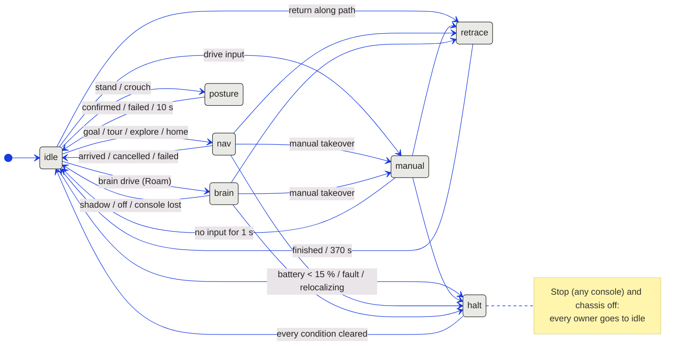

# Control arbitration

The control server lets exactly one source command motion at a time. Before this, about ten code paths
wrote the server's velocity command directly. Several conflicts followed from that:

- a second console could take over a running task;
- a posture change or a return along the driven path could start while brain drive kept writing commands;
- brain drive continued after every console had disconnected, because the brain rewrote the command on the
  next tick.

[`flyhead/server/arbiter.py`](../flyhead/server/arbiter.py) holds the single owner. The server only
forwards the owner's command (`Arbiter.command`), and every task request goes through
`Arbiter.request`.

## Owners

| Owner | Who commands motion | Ends when | Velocity sent |
| --- | --- | --- | --- |
| `idle` | nobody | a request is granted | zero |
| `manual` | the controlling console's drive input | 1 s without input; Stop; preempted by `retrace` | last input while its 0.3 s lease holds |
| `nav` | the planner (goal, tour and lap series, explore, return home); a fly reflex may command inside it (`reflex` flag) | arrival, cancel, failure; manual takeover; Stop; halt | planner or reflex command |
| `brain` | fly-brain drive through the envelope | brain mode shadow / off; controlling console lost; manual takeover; Stop; halt; idle crouch | envelope-limited brain command |
| `posture` | the chassis (stand / crouch transition) | the bridge reports `confirmed`, `failed`, `rejected` or `cancelled`; 10 s | zero |
| `retrace` | the robot bridge (return along the driven path) | `link_return` goes inactive; 370 s | zero from the server |
| `halt` | nobody (latched) | every halt condition has cleared | zero |

## Preemption

A request is granted when the owner is `idle`, or when the pair below allows the request to end the current
owner. Everything else is refused with the reason, for example `posture refused: brain is active (brain drive);
stop it first`.

| Request ↓ / current → | manual | nav | brain | posture | retrace | halt |
| --- | --- | --- | --- | --- | --- | --- |
| manual | — | ends nav | ends brain | refused | refused | refused |
| nav | refused | — | refused | refused | refused | refused |
| brain | refused | refused | — | refused | refused | refused |
| posture | refused | refused | refused | — | refused | allowed, halt stays |
| retrace | ends manual | ends nav | ends brain | refused | — | refused |
| Stop / chassis off | ends | ends | ends | ends | ends | stays latched |

The navigation handler also refuses a posture change while navigating, and brain drive during a navigation
task. The server's own idle crouch first ends brain drive. The low-battery crouch is sent while the halt keeps
ownership.

## Consoles

| Rule | Behaviour |
| --- | --- |
| Controlling console | The first console whose request is granted holds control. The status bar shows `Control <owner> · this console` or `· console N`. |
| Observers | Motion and task requests (drive, goal, tour, brain drive, posture, retrace, navigation parameters, route submits, guard reset) are refused with `console N holds control; use Take control first`. |
| Take control | An explicit button with a confirmation. A running task keeps running; a manual drive of the previous console ends. |
| Stop | Accepted from every console. |
| Controlling console lost | Manual drive and brain drive end at once. A navigation task continues on the server, as before. |

## Recording

Every transition is written once to the event log, for example `Control: idle -> brain (brain drive)`.
Every 10 Hz control record in `runs/live_*/navigation.jsonl` carries `owner`, `controller`, `reflex` and
`pose`. [`tools/collect_run.py`](../tools/collect_run.py) turns a run into a bundle with an owner-time table
and a transition table (see [field_test.md](field_test.md)).

## Verification

| Level | What | Result |
| --- | --- | --- |
| Unit | [`tests/test_arbiter.py`](../tests/test_arbiter.py): preemption pairs, two consoles, Stop, console loss, halt latch, posture timeout, reflex inside nav | 14 / 14 |
| Offline end to end | [`tools/arbiter_scenarios.py`](../tools/arbiter_scenarios.py) against the real control server | 33 / 33 checks (`runs/arbiter_offline_004`, operator PC) |
| Hardware | the same rules on the robot | not yet run |

The offline end-to-end run used a substitute for the robot and a substitute for the brain:

- [`tools/fake_bridge.py`](../tools/fake_bridge.py) speaks the bridge protocol. It models the robot
  kinematically (lease, deadline, speed ceiling), generates clouds from the real-site map package, and
  confirms posture after 1.5 s. It logs every received operation.
- [`tools/fake_brain_service.py`](../tools/fake_brain_service.py) is a stub. It returns a fixed FORWARD
  intent to every scan, and it is not the connectome.

What the checks cover:

- No motion reached the fake robot during a posture transition, from an observer, during a retrace or
  during a halt, nor 0.5 s after the controlling console was lost.
- Navigation kept running with no console connected.

These checks test the server's ownership logic. They do not test chassis, network or brain timing on
hardware.
