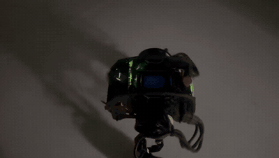
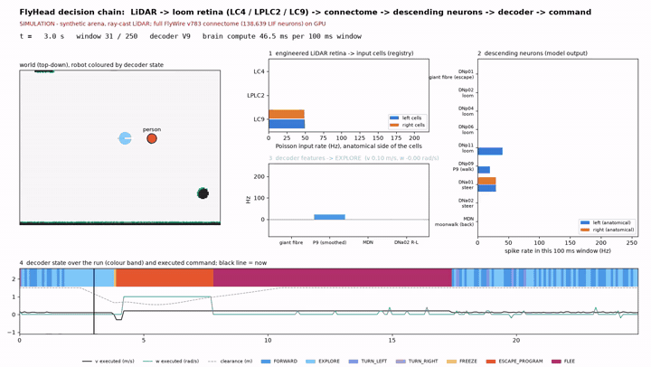
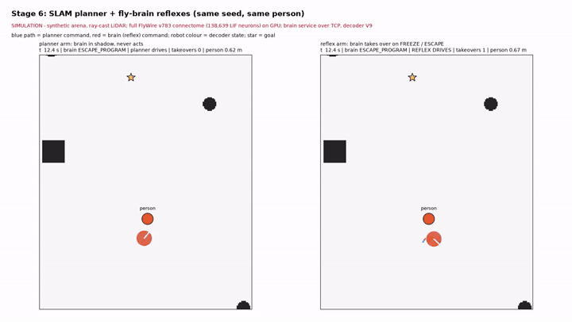
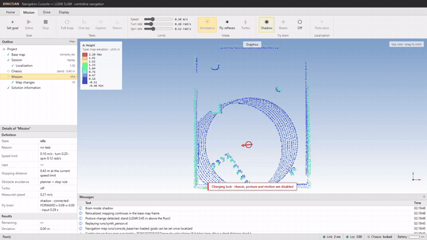

# Demos / 演示

Three kinds of footage, always labelled; they are not interchangeable:

| Label | Meaning |
| --- | --- |
| **REAL** / 真实执行 | the physical DIABLO robot, filmed on a phone |
| **SIM** / 仿真 | simulated world and LiDAR; the brain is the full connectome on the GPU |
| **CONSOLE (replay)** / 上位机回放 | the real operator console and control server, fed a synthetic LiDAR recording; brain in shadow mode (decisions shown, never sent) |

The retina is an engineered LiDAR-to-rate mapping onto registry-bound input cells, not a
reconstruction of fly vision. Left/right in the neuron panels is the anatomical side of the cells.

---

## 1. Real robot / 真实机器人

### 1.1 Brain drive with a person approaching — stage5_004 (2026-10-10)



Full clip (54 s, audio removed): [media/real/stage5_004_brain_drive_escape.mp4](media/real/stage5_004_brain_drive_escape.mp4)

* **What drives the robot:** the full-connectome brain (decoder V6) through the safety envelope and
  the 0.3 s command lease — no planner, no scripted path. A person walks up to the robot; looming
  in the LiDAR drives LC4 / LPLC2, the giant fibre and DNa02 respond, and the decoder issues escape
  programs (turn away, back off).
* **Which run:** the phone's recording time stamp (22:57:17, Beijing) falls inside the stage5_004
  drive window (22:53:38–22:58:03, `experiments/loom_005/runs/stage5_004/D1_start.txt`, `end.txt`).
  The clip may extend a few seconds past the end of the drive.
* **Recorded outcome of that run** (`experiments/loom_005/RESULTS.md`): 262 s drive, standing,
  0 contacts reported, 30 escape programs (15 frontal, 15 lateral), lateral turns up to 103°.
  Known defect visible in such runs: frontal reversals often lasted only 0.1–0.6 s because the
  frontal/lateral choice flip-flopped; later decoders (V7–V9) changed this.
* Supervision as in `PROTOCOL_STAGE5.md`: RC supervisor, geofence, speed limits 0.20 m/s forward,
  −0.30 m/s back, 1.0 rad/s.

### 1.2 Autonomous navigation clips (SLAM phase, before the brain modes)

These two clips show **autonomous navigation without the fly brain**: the robot drives planned
routes on a saved SLAM map (the classical layer in the README, section 1). The brain was not
involved. They were recorded before the first brain run (2026-10-10); the file timestamps are
2026-10-08, the day the navigation stack was rebuilt.

| Clip | Content |
| --- | --- |
| [media/real/hallway_posture_drive.mp4](media/real/hallway_posture_drive.mp4) (19 s) | standing / crouched posture changes and route driving in a hallway |
| [media/real/office_night_drive_4x.mp4](media/real/office_night_drive_4x.mp4) (6 min shown at 4×) | autonomous route driving through the office at night, in the environment of the SLAM maps |

Their numbers (lap times, speeds, stop distances) are in the README, section 1.8, from the same
period and the same navigation code.

---

## 2. Simulation / 仿真

### 2.1 The decision chain, window by window



Video (25 s, every 100 ms window of the run): [media/sim/decision_chain_person_front.mp4](media/sim/decision_chain_person_front.mp4) ·
still at the escape (t = 4.3 s): [media/sim/decision_chain_escape.png](media/sim/decision_chain_escape.png)

Scenario `person_front` (stage-3 criteria): a person walks toward the robot at 0.5 m/s and stops
0.7 m away. Decoder V9. Panels and where each number comes from:

| Panel | Shows | Code / log field |
| --- | --- | --- |
| world | arena, ray-cast LiDAR returns, person, robot coloured by decoder state | `flyhead/sim/loom_sim.py` (`World.scan`), row `x, y, yaw, objects` |
| 1 | Poisson rates written into LC4 / LPLC2 / LC9 cells, per anatomical side | `flyhead/fly/encoders/lidar_loom.py` (`LidarRetinaV3`), row `inputs` |
| 2 | spike rates of the descending neurons in this 100 ms window | `flyhead/fly/model.py` (`Brain.step`), registry `configs/fly/loom_registry.json`, row `readouts` |
| 3 | decoder features (giant fibre, P9, MDN, DNa02 R−L) and the decision | `flyhead/fly/decoders/loom.py` (`DecoderV9`), row `intent` |
| 4 | decision over the whole run and the executed command after the envelope | `flyhead/safety/envelope.py`, row `executed`, `envelope`, `clearance` |

In this run the brain freezes at 3.8 s and starts an escape program at 3.9 s (LC4 / LPLC2 on both
sides, giant fibre 125 Hz): it backs off at −0.3 m/s, turns, then flees for 9.6 s (7.8–17.4 s);
0 contacts.

### 2.2 Stage 6: planner + fly reflexes



Video: [media/sim/stage6_planner_vs_reflex.mp4](media/sim/stage6_planner_vs_reflex.mp4)

Same seed and person in both arms. Left: the SLAM planner drives, the brain runs in shadow.
Right: the brain takes over (red path) while it freezes or escapes, then the planner replans
around a keep-out disc. `flyhead/sim/reflex_sim.py` with the brain service over TCP
(`flyhead/fly/service.py`, `flyhead/server/brain_link.py`). Result of all three seeds:
[verification.md](verification.md) (STAGE 6 SIM PASSED).

---

## 3. Operator console / 上位机



Video (61 s): [media/console/console_replay_brain_shadow.mp4](media/console/console_replay_brain_shadow.mp4) ·
still: [media/console/console_brain_shadow.png](media/console/console_brain_shadow.png)

The unmodified console (`flyhead/monitor`) connected through its SSH tunnel to the control
server (`flyhead/server/app.py --replay`) on the GPU host, with the brain service running.

| Console element | Meaning |
| --- | --- |
| Graphics (point cloud) | the base map the session relocalized on; red arrow = robot pose, purple = driven path |
| Outline → Localization `1.00` | relocalization fitness on the base map (`flyhead/slam/reloc.py`) |
| Chassis `stand · 0.47 m` | posture detected from the LiDAR height above the map floor |
| Messages `Shared map committed … new obstacle` | the person detected as a change against the base map (`flyhead/slam/navmap.py`) |
| Fly brain `shadow · connected · TURN_LEFT v 0.14 w 0.20 · input 0.11 s` | live decoder state and the command it *would* send, input age; shadow = never sent |
| `Charging lock` banner | motion interlock on; replay has no robot link at all |

Honest limits of this clip: the LiDAR is synthetic and sparse in the 0.08–0.50 m band the retina
uses, so the brain's reaction to the walking person is weak here (LC9 drops, REST, then a turn as
the person leaves) — the escape behaviour is shown in 1.1 and 2.1.

---

## Regenerating / 复现这些素材

```bash
# simulation (logs from flyhead.sim.loom_sim / reflex_sim, see reproduce.md)
python tools/render_demo.py decision OUT.mp4 runs/person_front_brain.jsonl
python tools/render_demo.py still OUT.png runs/person_front_brain.jsonl 4.3
python tools/render_demo.py reflex OUT.mp4 runs/planner_seed1.jsonl runs/reflex_seed1.jsonl

# console replay (GPU host): recording with a person + navigation package in its SLAM frame
python tools/make_synthetic_raw.py runs/synth_person.xt --seconds 40 --person --base-out runs/console_base
python -m flyhead.server.app --replay runs/synth_person.xt --port 8091      # session once -> runs/replay_*/map.ply
bash scripts/start_brain_service.sh console_demo                              # LOOM_DECODER=9
XT_BRAIN_ENABLED=1 python -m flyhead.server.app --replay runs/synth_person.xt \
    --base runs/replay_<id>/map.ply --nav runs/console_base/nav --port 8091
# operator PC
python tools/export_preview_map.py --source <copy of runs/replay_<id>/map.ply>
python flyhead/monitor/preview.py --compute-host <alias>                     # Start LiDAR, then Mission -> Shadow
```

---

## Real-site map renders / 真实场地地图的渲染

The decision and stage-6 renders above use the synthetic arena. Renders on the saved SLAM map of a
real site (`onboard_20260926_manual_cleanup_20261005`, the map the stage-3 and stage-5 sims were
written against) exist locally and are **not published** here: the map is a floor plan of a real
building. Publishing them needs the owner's approval. The sim runs on that map give 0 contacts for
the brain in the person_front scenario. Stage 6 on that map (seed 1): the planner arm arrives; the
reflex arm arrived in one repeat (139.7 s, 2 takeovers, 0 contacts) and timed out at 180 s in an earlier
run with the same code and seed (5 takeovers, 0 contacts). The difference is run-to-run variation of the
real-time simulation, not yet explained.
